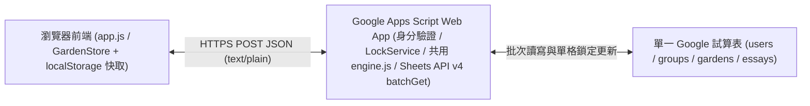
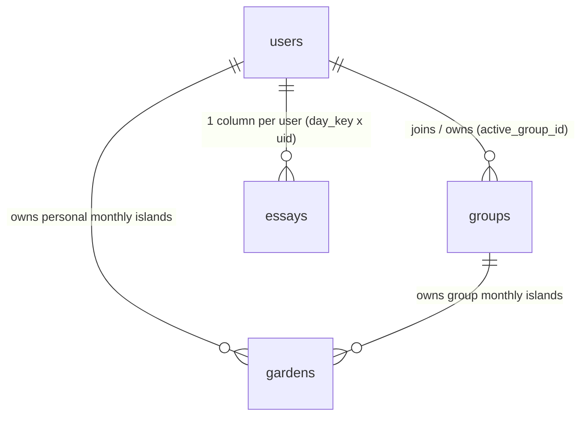

# 隨筆花園（Essay Garden）Google Sheets 資料庫完整規格書

## §1 文件資訊與系統總覽

- **盤點基準版本**：`v=20261120l`
- **盤點範圍檔案**：
  - [index.html](file:///d:/Antigravity%20workspaces/交通美地/index.html)
  - [app.js](file:///d:/Antigravity%20workspaces/交通美地/app.js)
  - [store.js](file:///d:/Antigravity%20workspaces/交通美地/store.js)
  - [engine.js](file:///d:/Antigravity%20workspaces/交通美地/engine.js)
  - [game-config.json](file:///d:/Antigravity%20workspaces/交通美地/game-config.json)
  - [catalog.json](file:///d:/Antigravity%20workspaces/交通美地/catalog.json)
  - [test_verification.py](file:///d:/Antigravity%20workspaces/交通美地/test_verification.py)
- **文件目的**：作為本專案從「純本機 `localStorage` 原型」升級為「Google Sheets 雲端資料庫 + 多人真實同步」之唯一資料庫與 API 實作規格依據。本文件僅定義規格，尚未修改任何現有程式碼。

### 1.1 三層系統架構

瀏覽器前端**不得**直接持有試算表 Service Account 憑證或直寫 Google Sheets（會導致金鑰外洩、他人私密隨筆在讀取整表時外流、多人併發覆蓋資料等風險）。所有雲端讀寫必須透過 Google Apps Script (GAS) Web App 作為權威後端中間層：



### 1.2 資料分層原則

| 資料層級 | 儲存位置 | 涵蓋內容 | 同步與管理方式 |
| :--- | :--- | :--- | :--- |
| **雲端持久化資料（4 表）** | Google Sheets | `users`、`groups`、`gardens`（含 `items_json`）、`essays`（矩陣） | 透過 GAS Web App 依指令式 Action 原子讀寫 |
| **靜態唯讀設定（不入庫）** | 前端靜態 JSON | [game-config.json](file:///d:/Antigravity%20workspaces/交通美地/game-config.json)、[catalog.json](file:///d:/Antigravity%20workspaces/交通美地/catalog.json) | 與 `assets/` 圖檔一起隨前端版本 `ASSET_VER` 發布並納入 Git 版控，避免無謂讀表延遲 |
| **純本機資料（不入庫）** | 瀏覽器 `localStorage` | `essay_garden_session_v1`（永不過期 `sessionToken`）、`essay_garden_state_v4`（離線／啟動快取）、`essay_garden_card_style_v1`（便條紙偏好本機快取）、`timeOffsetDays`（僅限本機除錯測試模式） | `timeOffsetDays` 嚴禁送入雲端；登入後由 `users.last_card_style` 同步回寫本機偏好 |

> **靜態設定盤點摘要**：
> - `game-config.json` 定義：`dayBoundaryHour: 4`、`minWords: 10`、`dailySeedCap: 3`、`seedBagCap: 30`、`homeEssayLimit: 10`、`rarityFormula: { cap: 100, offset: 10 }`、`pityThreshold: 10`、`decomposeEnergy`（`common: 2, rare: 5, epic: 10, legendary: 20`）、`dailyBaseEnergy: 10`、`streakMultipliers: [[1, 1], [7, 1.5], [30, 2]]`、`overflowWordsPerEnergy: 10`、`milestones: [7, 30, 100, 365]`、`clearWitheredCost: 5`、`makeUpCost: 30`、`regionSize: { personal: 5, group: 6 }`、`expansionCosts: [100, 250, 500, 800]`、`groupGrowthMultiplier: { "1": 1, "2": 1.5, "3": 2, "4": 2.5, "5": 3 }`、`maxGroupMembers: 5`、`beauty`（`rarityWeight: { common: 1, rare: 2, epic: 4, legendary: 8 }`、`decorDivisor: 10`、`witheredPenalty: 2`）以及 `spriteScale`。
> - `catalog.json` 定義：3 個主題（`flowerbed`、`forest`、`oasis`）、46 種植物（每主題 12 種 + `common` 6 種 + `limited` 4 種）、6 種裝飾品（`dec_lantern`、`dec_bench`、`dec_pond`、`dec_rock`、`dec_torii`、`dec_arch`）與 5 種動態天候背景（`morning` 預設免費、`sunset`、`night`、`rain`、`bubbles`）。

### 1.3 設計定位與 Google Sheets 硬限制

- **目標規模**：專為 **1～100 位熟人／小圈子**（每團上限 5 人）最佳化；於此規模下，矩陣式 `essays` 結合 4 表半正規化架構之讀取效能與格數利用率優於傳統長表。
- **Google Sheets 硬限制**：
  - 單一儲存格內容上限：**50,000 字元**
  - 單張工作表最大欄數：**18,278 欄**（`A`～`ZZZ`）
  - 整本試算表儲存格總數上限：**10,000,000（1,000 萬）格**

---

## §2 專案功能與資料契約盤點（實碼核實）

### 2.1 畫面與彈窗讀寫面盤點

專案包含 **3 大主畫面** 與 **13 個互動彈窗**，其資料讀寫需求整理如下：

| 畫面 / 彈窗 | 位置對照 | 讀取資料 | 觸發寫入操作 |
| :--- | :--- | :--- | :--- |
| **首頁 (`screen-home`)** | [index.html#L231-L280](file:///d:/Antigravity%20workspaces/交通美地/index.html#L231-L280) | `users` 狀態列、可見隨筆（限 `homeEssayLimit: 10` 則）、當前與歷史 `gardens`、優先提示條 | 無（點擊進入彈窗或切換檢視） |
| **全螢幕花園 (`screen-garden`)** | [index.html#L283-L334](file:///d:/Antigravity%20workspaces/交通美地/index.html#L283-L334) | `gardens.items_json`、成員名稱與連勝、`userDays` / `groupDays`（推算植物等級與美觀度） | 點格觸發種植、擺放、移動、清除或開彈窗 |
| **所有隨筆頁 (`screen-essays`)** | [index.html#L337-L351](file:///d:/Antigravity%20workspaces/交通美地/index.html#L337-L351) | 按月份分群、依 `dayKey` 排列之可見隨筆 | 反應按鈕切換 |
| **1. 寫作編輯器 (`editor`)** | [app.js#L1341-L1432](file:///d:/Antigravity%20workspaces/交通美地/app.js#L1341-L1432) | `user.pity`、`canMakeUpYesterday()`、`last_card_style` | `submitEssay`、`makeUpYesterday` |
| **2. 完成結算 (`reward`)** | [app.js#L1435-L1497](file:///d:/Antigravity%20workspaces/交通美地/app.js#L1435-L1497) | `submitEssay` 回傳之獎勵結果 | 「馬上種下」切至種植模式 |
| **3. 閱讀／編輯隨筆 (`read_essay`)** | [app.js#L1500-L1571](file:///d:/Antigravity%20workspaces/交通美地/app.js#L1500-L1571) | 單篇隨筆內容、`reactions`、是否作者本人 | `updateEssay`、`setReaction` |
| **4. 植物詳情 (`plant_detail`)** | [app.js#L1574-L1657](file:///d:/Antigravity%20workspaces/交通美地/app.js#L1574-L1657) | 植物實體 + `evalState` + 種植者暱稱 | `makeUpYesterday`、`clearDeadPlant`、`moveGridItem` |
| **5. 裝飾詳情 (`decor_detail`)** | [app.js#L1660-L1703](file:///d:/Antigravity%20workspaces/交通美地/app.js#L1660-L1703) | 裝飾物件、`placedBy` 權限、美觀度加成 | `moveGridItem`、`removeDecor` |
| **6. 空格快速選單 (`cell_picker`)** | [app.js#L1706-L1783](file:///d:/Antigravity%20workspaces/交通美地/app.js#L1706-L1783) | `user.seeds`、`user.limitedSeeds`、`user.energy`、`garden.status` | `plantSeed`、`buyAndPlaceDecor` |
| **7. 種子袋 (`bag`)** | [app.js#L1786-L1865](file:///d:/Antigravity%20workspaces/交通美地/app.js#L1786-L1865) | `user.seeds`、`user.limitedSeeds` | `decomposeSeed`、選種進入放置模式 |
| **8. 商店／擴地 (`shop`)** | [app.js#L1868-L1938](file:///d:/Antigravity%20workspaces/交通美地/app.js#L1868-L1938) | 活動花園 `size` / `expansions`、`user.energy` | `expandGarden`、選購裝飾進入放置模式 |
| **9. 植物圖鑑 (`dex`)** | [app.js#L1941-L1966](file:///d:/Antigravity%20workspaces/交通美地/app.js#L1941-L1966) | `user.dex`（對照 `catalog.json` 46 品種） | 唯讀 |
| **10. 月份相簿 (`album`)** | [app.js#L1969-L2005](file:///d:/Antigravity%20workspaces/交通美地/app.js#L1969-L2005) | 名下個人花園與當前團體花園之所有歷史／快照島 | 切換檢視目標 `gardenId` |
| **11. 團體經營 (`group`)** | [app.js#L2008-L2152](file:///d:/Antigravity%20workspaces/交通美地/app.js#L2008-L2152) | `groups` 成員、今日寫作貢獻、種子計數、主題投票 | `createGroup`、`joinGroup`、`leaveGroup`、`castThemeVote` |
| **12. 強制換月選主題 (`theme_picker`)** | [app.js#L2155-L2184](file:///d:/Antigravity%20workspaces/交通美地/app.js#L2155-L2184) | 當月 `month`（僅個人模式在換月時彈出） | `startNewMonthGarden` |
| **13. 設定面板 (`settings`)** | [app.js#L2187-L2260](file:///d:/Antigravity%20workspaces/交通美地/app.js#L2187-L2260) | `user.displayName`、`timezone`、當前遊戲日 | `updateDisplayName`（雲端版隱藏開發測試器） |

### 2.2 關鍵領域規則與枚舉契約

1. **遊戲日與時區規則**
   - 依 [engine.js#L4-L17](file:///d:/Antigravity%20workspaces/交通美地/engine.js#L4-L17)，每天以凌晨 **04:00**（`dayBoundaryHour: 4`）作為換日邊界，回傳 `YYYY-MM-DD`。
   - 個人模式依 `users.timezone` 計算遊戲日；團體模式依 `groups.timezone` 計算，確保團內成員共享同一套日切與月切基準。
   - **雲端權威時間**：所有寫入與 `dayKey` 判定一律以 GAS 伺服器當下 `Date.now()` 為準。
2. **隨筆隱私與心情反應規則**
   - 對齊 [store.js#L546](file:///d:/Antigravity%20workspaces/交通美地/store.js#L546)、[store.js#L611](file:///d:/Antigravity%20workspaces/交通美地/store.js#L611) 與 [app.js#L888,L1420,L1504](file:///d:/Antigravity%20workspaces/交通美地/app.js#L888)：
     - **個人模式**預設 `private: true`，但因當前花園不屬於團體（`isGroup === false`），仍允許作者本人對自己的隨筆點擊或長按表情反應。
     - **團體模式**預設 `private: false`，同團成員皆可閱讀與按反應；若作者勾選 `private: true`，則**僅作者本人可見**且禁止反應（畫面顯示鎖頭圖示），但**該篇隨筆仍會計入團體每日 3 顆種子名額與當日植物成長貢獻**。
   - 輪播與「所有隨筆頁」之可見範圍（對齊 [store.js#L426-L441](file:///d:/Antigravity%20workspaces/交通美地/store.js#L426-L441)）：使用者自己的全部隨筆（跨所有歷史個人與團體）＋目前所屬團體中其他成員的公開（`private: false`）隨筆。
3. **枚舉值契約（Enums）**
   - 主題 `theme`：`'flowerbed' | 'forest' | 'oasis'`
   - 便條紙樣式 `cardStyle`：`'card1' | 'card2' | 'card3' | 'card4' | 'card5' | 'card6' | 'card7'`（或 `null` 時由 `id` 雜湊決定預設款）
   - 表情反應 `reactionId`：`'sparkle'`（感動）｜`'sprout'`（萌芽）｜`'hug'`（抱抱）｜`'cheer'`（加油）｜`'love'`（喜歡）
   - 花園狀態 `status`：`'active' | 'archived' | 'snapshot'`
4. **花園狀態權限矩陣**
   對齊 [store.js#L727,L765,L786,L805,L819,L857](file:///d:/Antigravity%20workspaces/交通美地/store.js#L727)：

   | 花園 `status` | 種植新植物 (`plantSeed`) | 擴地 (`expandGarden`) | 購買擺放 / 移動 / 拆除裝飾 (`decor`) | 移動植物 / 清除枯枝 (`plant`) |
   | :--- | :---: | :---: | :---: | :---: |
   | `active` | 允許 | 允許 | 允許（僅限本人擺放之裝飾） | 允許（移動限本人；清枯枝僅限 `dead`） |
   | `archived` | 禁止 | 禁止 | **允許** | **允許** |
   | `snapshot` | 禁止 | 禁止 | 禁止（完全唯讀） | 禁止（完全唯讀） |

5. **植物惰性結算與救活視窗**
   - 種下當日固定顯示 `Lv1`；隔日起依 `userDays`（個人）或 `groupDays`（團體）每日貢獻推進進度至 `requiredDays` 成熟（全程無枯萎為 `perfect`，曾枯萎則顯示 `Lv5`）。
   - 連續缺寫 1 天進入 `withering`（當天寫作或補寫昨天可恢復原等級，但失去 `perfect`）；連續缺寫 2 天進入 `dead`。
   - **救活視窗**（對齊 [test_verification.py#L254-L300](file:///d:/Antigravity%20workspaces/交通美地/test_verification.py#L254-L300)）：在剛跨入 `dead` 的**當天**（僅昨天與前天缺寫），花 30 能量補寫昨天（`makeUpYesterday`）仍可救活植物；若連缺 **3 天以上**則成為不可逆死亡。
6. **換月與團體投票**
   - 團體於每月最後一天（`isLastDayOfMonth(todayKey)`）開啟次月主題投票。
   - 進入新月份時，團體由 `resolveGroupThemeVote(groupId, month, votes)` 自動定案並建立 `6×6` 新月花園（原月轉為 `archived`）；個人則彈出 `theme_picker` 讓使用者選定主題後建立 `5×5` 新月花園。

---

## §3 資料庫邏輯模型與 4 張工作表完整 Schema

本資料庫將舊版原型中的 `region` 語意重命名為直觀的 **`gardens`**（每人或每團每個月 1 列），將植物與裝飾直接收斂於 `items_json` 中，並移除可由 `essays` 衍生計算的 `user_days` 與 `garden_days` 表，使整本試算表僅保留 **4 張工作表**：`users`、`groups`、`gardens`、`essays`。



### 3.1 工作表 `users`（使用者主檔，每人 1 列）

| 欄位名稱 | 試算表格式 | 邏輯型別 | 必填 / 預設 | 約束與說明 |
| :--- | :--- | :--- | :--- | :--- |
| `uid` | 純文字 (`@`) | `string` | 必填 (PK) | 使用者唯一識別碼（建議前綴 `u_`，如 `u_a1b2c3d4`） |
| `username` | 純文字 (`@`) | `string` | 必填 (Unique) | 登入帳號；比對時以 `trim().toLowerCase()` 正規化，允許中英數與 `_` `-` `.`，長度 `2`～`24` 字元，禁止空白與控制字元 |
| `password_hash` | 純文字 (`@`) | `string` | 必填 | 密碼單向加鹽雜湊，格式 `s256$<salt>$<hex>`（每帳號獨立隨機鹽 + 迭代 SHA-256）；試算表絕不存明文密碼，且**所有 API 絕不回傳** |
| `session_hashes_json` | 純文字 (`@`) | `JSON Array` | `"[]"` | 存放各已登入裝置的 `SHA-256(sessionToken)` 陣列；**永不過期**、支援多裝置同時登入不互踢，僅於該裝置主動呼叫 `logout` 時移除對應雜湊；試算表不存明文 token，且**所有 API 絕不回傳** |
| `display_name` | 純文字 (`@`) | `string` | 必填 | 使用者暱稱（寫入時防公式注入，trim 後 1～30 字） |
| `timezone` | 純文字 (`@`) | `string` | 必填 | IANA 時區字串，例：`Asia/Taipei` |
| `active_group_id` | 純文字 (`@`) | `string` | `""` | FK → `groups.group_id`。空字串表示目前處於個人花園模式 |
| `energy` | 數值 (`0`) | `number` | `65` | 目前持有能量（非負整數） |
| `pity` | 數值 (`0`) | `number` | `0` | 種子稀有度保底累積次數（`0`～`10`） |
| `streak_count` | 數值 (`0`) | `number` | `0` | 目前連續寫作天數 |
| `streak_last_day` | 純文字 (`@`) | `string` | `""` | 最後計入連勝的遊戲日（`YYYY-MM-DD`，純文字） |
| `streak_prev_count` | 數值 (`0`) | `number` | `0` | 斷簽前連勝天數（供 `repairStreakOnMakeUp` 修復用） |
| `streak_prev_last_day` | 純文字 (`@`) | `string` | `""` | 斷簽前最後遊戲日（`YYYY-MM-DD`，純文字） |
| `seeds_json` | 純文字 (`@`) | `JSON Object` | `"{}"` | 一般種子背包，例：`{"fb_c1":1,"fb_r1":2}`（總顆數上限 `30`） |
| `limited_seeds_json` | 純文字 (`@`) | `JSON Object` | `"{}"` | 里程碑限定植物背包，例：`{"lim_7":1}`（不占背包上限） |
| `milestones_json` | 純文字 (`@`) | `JSON Array` | `"[]"` | 已領取里程碑陣列，例：`[7,30]` |
| `dex_json` | 純文字 (`@`) | `JSON Array` | `"[]"` | 已解鎖植物圖鑑品種陣列，例：`["fb_c1","fb_r1"]`（較現行 Map 省字元） |
| `last_card_style` | 純文字 (`@`) | `string` | `"card1"` | 上次使用之便條紙樣式（`card1`～`card7`） |
| `makeup_days_json` | 純文字 (`@`) | `JSON Array` | `"[]"` | 個人執行過「補寫昨天」之日期陣列（`["2026-11-18"]`），用於衍生 `userDays.madeUp` |
| `created_at` | 數值 (`0`) | `number` | 必填 | Unix 毫秒時間戳 |
| `updated_at` | 數值 (`0`) | `number` | 必填 | Unix 毫秒時間戳 |
| `bg_themes_json` | 純文字 (`@`) | `JSON Object` | `'{"unlocked":["morning"],"active":"morning"}'` | 使用者已解鎖與目前啟用之天候動態背景狀態 |

### 3.2 工作表 `groups`（小圈子團體主檔，僅開團才建 1 列）

> 相較舊版 [store.js](file:///d:/Antigravity%20workspaces/交通美地/store.js#L174,L329)：移除獨立的 `invites` 與 `garden.members` 冗餘快取（改由 `invite_code` 與 `users` 表即時組裝），並新增 `former_member_uids_json` 以保留已退團成員過去對團體植物成長的貢獻。

| 欄位名稱 | 試算表格式 | 邏輯型別 | 必填 / 預設 | 約束與說明 |
| :--- | :--- | :--- | :--- | :--- |
| `group_id` | 純文字 (`@`) | `string` | 必填 (PK) | 團體唯一 ID，例：`grp_1763600000_x9a2` |
| `name` | 純文字 (`@`) | `string` | 必填 | 團體名稱 |
| `owner_uid` | 純文字 (`@`) | `string` | 必填 | 開團者 `uid` |
| `status` | 純文字 (`@`) | `string` | `"active"` | `'active'`（運作中）｜`'archived'`（全體成員皆退團後封存） |
| `invite_code` | 純文字 (`@`) | `string` | 條件唯一 | 6 碼大寫英數邀請碼；`status === 'active'` 之團體間必須唯一，封存後清空 |
| `member_uids_json` | 純文字 (`@`) | `JSON Array` | 必填 | 現任成員 `uid` 陣列（長度 `1`～`5`） |
| `former_member_uids_json` | 純文字 (`@`) | `JSON Array` | `"[]"` | 已退團前成員 `uid` 陣列；後端彙算歷史 `groupDays` 與植物進度時須納入此清單，避免前成員退團導致舊貢獻消失、原團體植物倒退或枯死 |
| `timezone` | 純文字 (`@`) | `string` | 必填 | 團體共用 IANA 時區（以開團者時區為準） |
| `theme_vote_month` | 純文字 (`@`) | `string` | `""` | 投票中之目標月份（`YYYY-MM`，非投票期或開票後為空字串） |
| `theme_votes_json` | 純文字 (`@`) | `JSON Object` | `"{}"` | 成員投票紀錄，例：`{"u_1":"forest","u_2":"oasis"}` |
| `makeup_days_json` | 純文字 (`@`) | `JSON Array` | `"[]"` | 團體補寫紀錄日期陣列（`["2026-11-18"]`）；團體任一成員執行 `makeUpYesterday` 時寫入，保住全團植物 |
| `created_at` | 數值 (`0`) | `number` | 必填 | Unix 毫秒時間戳 |
| `updated_at` | 數值 (`0`) | `number` | 必填 | Unix 毫秒時間戳 |

### 3.3 工作表 `gardens`（每人或每團每月 1 列 + 退團快照 1 列）

> 對應並取代舊版 [store.js](file:///d:/Antigravity%20workspaces/交通美地/store.js#L183-L296) 中的 `regions`。

| 欄位名稱 | 試算表格式 | 邏輯型別 | 必填 / 預設 | 約束與說明 |
| :--- | :--- | :--- | :--- | :--- |
| `garden_id` | 純文字 (`@`) | `string` | 必填 (PK) | 島嶼區域 ID，例：`g_202611_a1b2` 或 `snap_202611_c3d4` |
| `owner_type` | 純文字 (`@`) | `string` | 必填 | `'personal'`（個人島或個人擁有的退團快照）｜`'group'`（團體島） |
| `owner_id` | 純文字 (`@`) | `string` | 必填 (FK) | `owner_type === 'personal'` 時為 `uid`；`owner_type === 'group'` 時為 `group_id` |
| `month` | 純文字 (`@`) | `string` | 必填 | 所屬月份（`YYYY-MM`，純文字） |
| `theme` | 純文字 (`@`) | `string` | 必填 | `'flowerbed' | 'forest' | 'oasis'` |
| `status` | 純文字 (`@`) | `string` | `"active"` | `'active'`（當月活動）｜`'archived'`（過往月份或進團時暫封存的個人島）｜`'snapshot'`（退團團體唯讀快照） |
| `snapshot_name` | 純文字 (`@`) | `string` | `""` | 僅 `status === 'snapshot'` 時填入，例：`晨光共筆團（快照）` |
| `size` | 數值 (`0`) | `number` | `5` / `6` | 土地邊長（個人初始 `5`、團體初始 `6`，擴地上限 `9`） |
| `expansions` | 數值 (`0`) | `number` | `0` | 已擴充次數（`0`～`4`） |
| `items_json` | 純文字 (`@`) | `JSON Object` | `'{"plants":{},"decor":{}}'` | 島上全部植物與裝飾的單一 JSON 物件 |
| `created_at` | 數值 (`0`) | `number` | 必填 | Unix 毫秒時間戳 |
| `updated_at` | 數值 (`0`) | `number` | 必填 | Unix 毫秒時間戳 |

#### `items_json` 內部結構規範

```json
{
  "plants": {
    "p_1763600000_a1b2": {
      "id": "p_1763600000_a1b2",
      "speciesId": "fb_l1",
      "x": 1,
      "y": 1,
      "plantedBy": "u_me",
      "plantedDay": "2026-11-14",
      "plantedAt": 1763092800000,
      "requiredDays": 5,
      "limited": false,
      "finalStage": "grown",
      "hadWilt": false,
      "finalLevel": 5,
      "frozen": null
    }
  },
  "decor": {
    "d_1763600100_c3d4": {
      "id": "d_1763600100_c3d4",
      "itemId": "dec_lantern",
      "x": 1,
      "y": 3,
      "placedBy": "u_me",
      "placedAt": 1763600100000
    }
  }
}
```

- **單格互斥約束**：同一 `(x, y)` 在 `plants` 與 `decor` 中只能存在最多 1 件物件，由 GAS 在鎖內以 `isCellOccupied` 嚴格檢查（`0 <= x < size` 且 `0 <= y < size`）。
- **`frozen` 物件結構（僅 `status === 'snapshot'`）**：`{ "stage": "growing|grown|withering|dead", "progress": 2, "level": 3, "hadWilt": false, "isPerfect": false }`；非快照區域為 `null`。
- **容量安全證明**：[store.js#L857](file:///d:/Antigravity%20workspaces/交通美地/store.js#L857) 鎖定最大尺寸為 `9×9 = 81` 格，每格最多 1 物。單株植物（含退團 `frozen`）JSON 約 280～300 字元，極端情況 **81 格全滿植物加快照** 總長約 **24,300 字元**，遠低於 Google Sheets 單格 50,000 字元硬上限。

### 3.4 工作表 `essays`（矩陣式工作表：`日期列 × 使用者欄`）

利用試算表的二維座標免費建立 `(day_key, uid)` 雙索引，免除傳統長表的全表掃描與列號位移問題：

| 列 \ 欄 | **A 欄（日期索引，純文字 `@`）** | **B 欄（`u_1`）** | **C 欄（`u_2`）** | **D 欄（`u_3`）** |
| :--- | :--- | :--- | :--- | :--- |
| **第 1 列（表頭）** | `day_key` | `u_1` | `u_2` | `u_3` |
| **第 2 列** | `2026-11-19` | `[{...}, {...}]` | *(空儲存格)* | `[{...}]` |
| **第 3 列** | `2026-11-20` | `[{...}]` | `[{...}]` | *(空儲存格)* |

#### 矩陣運作規則與儲存格 Schema

1. **動態欄位註冊**：新使用者首次建立帳號時，於 `LockService` 內在 `essays` 第 1 列最右側追加該 `uid` 作為新欄表頭；後端任何操作永遠動態讀取第 1 列取得 `uid -> colIndex` 映射。
2. **動態日期列對應**：因不同時區使用者可能讓 `A` 欄日期出現微幅非單調（例如台北已 `2026-11-20`、美西剛寫 `2026-11-19`），GAS 必須讀取 `A2:A` 建立 `dayKey -> rowIndex` 映射，禁止以起始日算術推算列號；寫入新日期若不在 `A` 欄中，則於尾端新增一列。
3. **儲存格內容**：每個 `(day_key, uid)` 非空儲存格存放該使用者在該遊戲日發表之隨筆 **JSON 陣列**（無隨筆時保持完全空白）。寫入前須檢查序列化字串長度 **`<= 49,000` 字元**（保留餘裕防撞 50,000 上限）。
4. **單篇隨筆物件結構**（`authorUid` 由欄位表頭決定、`dayKey` 由 `A` 欄決定、`authorName` 由 `users` 表即時解析，故不冗餘重複儲存於每篇 JSON 中）：

```json
[
  {
    "id": "e_20261120_1763600000_a3f9",
    "gardenId": "g_202611_a1b2",
    "groupId": "",
    "content": "傍晚散步經過巷口的花店...",
    "wordCount": 58,
    "private": true,
    "cardStyle": "card1",
    "reward": { "type": "seed", "speciesId": "fb_c1" },
    "reactions": { "u_1": "love" },
    "createdAt": 1763600000000,
    "updatedAt": 1763600000000
  }
]
```

- `id` 建議格式：`e_YYYYMMDD_<timestampMs>_<rand4>`（同時保留顯式 `dayKey` 與 `authorUid` 參數在更新／反應 API 中，確保 $O(1)$ 直達單格）。
- `groupId`：寫於個人花園時為 `""`；寫於團體花園時為該 `group_id`。
- `reward`：與現行 [store.js#L558-L561](file:///d:/Antigravity%20workspaces/交通美地/store.js#L558-L561) 一致，抽中種子（含滿袋分解 `seed_decomposed`）均記錄 `{ "type": "seed", "speciesId": "<id>" }`；超過每日種子上限則記錄 `{ "type": "energy", "energy": <n> }`。
- `reactions`：Map `{ [uid]: reactionId }`。
- **擴充預留**：若日後新增「刪除隨筆」功能，可於單篇物件補上選填 `deletedAt`（軟刪除時間戳），讓該篇隨筆不顯示於畫面、但仍納入當日已耗用種子名額計算。

---

## §4 衍生統計彙算與植物懶回寫規則

本架構不設置 `user_days` 與 `garden_days` 實體表，改由 GAS 後端依 `essays`、`users.makeup_days_json`、`groups.makeup_days_json` 動態彙算並提供給前端與 `engine.js`。

### 4.1 衍生統計彙算公式

1. **個人每日統計 `userDays[dayKey]`**（涵蓋該 `uid` 在個人與所有曾待過團體的隨筆）：
   - 取 `essays` 中 `uid` 直欄在 `dayKey` 列的全部隨筆陣列 `list`：
     - `essays` = `list.length`
     - `words` = `sum(e.wordCount)`
     - `lastEssayAt` = `max(e.createdAt)`（若無則 `0`）
     - `madeUp` = `users.makeup_days_json.includes(dayKey)`
   - **個人當日已發種子數**：`list.filter(e => e.groupId === "" && e.reward.type === "seed").length`（注意：依現有邏輯 [store.js#L459-L485](file:///d:/Antigravity%20workspaces/交通美地/store.js#L459-L485)，個人與團體每日 `seedsGiven` 各自依花園獨立計算，互相切換前後不共用上限）。
2. **團體每日統計 `groupDays[dayKey]`**：
   - 取 `u ∈ (group.member_uids ∪ group.former_member_uids)` 每位成員在 `essays` 中 `dayKey` 列裡 **`e.groupId === group.group_id`** 的隨筆集合 `gList`（**必須包含 `e.private === true` 的私密隨筆**）：
     - `seedsGiven` = `gList.filter(e => e.reward.type === "seed").length`
     - `writers` = `{ [authorUid]: max(e.createdAt) }`（對每個有在該日該團發文的 `authorUid` 寫入時間戳）
     - `madeUp` = `groups.makeup_days_json.includes(dayKey)`
3. **隱私過濾執行順序**：
   - GAS **必須先**用完整資料（含他人私密隨筆）計算完 `groupDays` 與執行獎勵／植物推算，**最後**才過濾掉 `authorUid !== currentUid && e.private === true` 的隨筆再回傳前端。

### 4.2 植物最終狀態懶回寫（Lazy Materialization）

[engine.js#L148-L162](file:///d:/Antigravity%20workspaces/交通美地/engine.js#L148-L162) 已內建 `finalStage` 短路機制：只要植物已有 `finalStage`，`evaluatePlantState()` 就不再掃描每日紀錄。為避免試算表歷經數年後每次 `bootstrap` 都要彙算全部歷史 `essays` 列，規定如下懶回寫策略：

- **成熟定案**：當任意寫入請求或 `bootstrap` 掃描未定案植物，發現 `evalState.stage === 'grown'` 時，立即將該植物物件寫回：
  - `finalStage = 'grown'`
  - `hadWilt = Boolean(evalState.hadWilt)`
  - `finalLevel = 5`
- **永久死亡定案**：**僅當** `evalState.stage === 'dead'` **且** 連缺已達 3 天以上（`!canRescuePlantByMakeUp`，已過補寫昨天救活視窗）時，才寫回：
  - `finalStage = 'dead'`
  - `hadWilt = true`
  - `finalLevel = evalState.level`（保留枯死前最後等級 `1`～`4`，須配合 §7 第 1 點修正 `engine.js`）
- **查詢視窗收斂**：只要所有過去月份／活動花園中未定案植物的 `finalStage` 皆已懶回寫，GAS 計算 `userDays` / `groupDays` 時只需抓取**「最早未定案植物 `plantedDay` 前 2 天 ～ 今日」**之 `essays` 尾端列區間（無未定案植物時最少抓取近期 7 天供連勝與補簽判定即可），徹底實現 $O(1)$ 常數級啟動延遲。

---

## §5 GAS Web App API 通訊規格

### 5.1 傳輸與封裝規約

- **端點與 Method**：單一 GAS Web App URL，所有請求一律採 `POST`。
- **避開 CORS 預檢**：GAS 不支援自訂 `OPTIONS` 預檢回應；前端 `fetch` 必須設定 `headers: { 'Content-Type': 'text/plain;charset=utf-8' }` 並傳送 JSON 字串，GAS 端使用 `JSON.parse(e.postData.contents)` 解析。
- **統一請求格式**：
  ```json
  {
    "action": "submitEssay",
    "authToken": "<永不過期 sessionToken（ping 與 auth 免帶）>",
    "payload": { ... }
  }
  ```
- **統一回應格式**：
  ```json
  // 成功
  { "ok": true, "serverTimeMs": 1763641714000, "data": { ... } }

  // 失敗
  { "ok": false, "serverTimeMs": 1763641714000, "code": "INSUFFICIENT_ENERGY", "message": "能量不足（需 30 能量）" }
  ```

### 5.2 身分驗證機制（單一帳密彈窗 + 永不過期多裝置 Session）

本專案**不設置獨立註冊頁面或登入／註冊切換分頁**，採用帳號／密碼合一入口與永不過期 Session：

1. **首次進入彈窗（登入／自動建帳合一）**：
   - 前端啟動時檢查 `localStorage['essay_garden_session_v1']`；若不存在（首次使用或已登出），立即跳出單一「進入隨筆花園」視窗，要求輸入帳號與密碼（提示：`新帳號將自動建立，既有帳號將直接登入`）。
   - 前端呼叫 `POST { action: "auth", payload: { username, password, timezone } }`（密碼最小長度 `4` 字元；`username` 不允許空白與控制字元，`2`～`24` 字元）。
2. **GAS 端分流邏輯（於 `LockService` 鎖內執行）**：
   - 以 `trim().toLowerCase()` 正規化 `username` 查找 `users.username`：
     - **帳號已存在 → 視為登入**：以儲存格 `password_hash`（`s256$<salt>$<hex>`）進行常數時間比對驗證。密碼相符即核發一組高熵 256-bit 隨機 `sessionToken`，將 `SHA-256(sessionToken)` **追加**進 `session_hashes_json`（保留其他已登入裝置不互踢），並連同完整初始 `bootstrap` 資料一次回傳（`isNewUser: false`）；若密碼錯誤回傳 `AUTH_INVALID`（提示「此帳號已存在，但密碼不正確；若要建立新帳號請換一個帳號」）。
     - **帳號不存在 → 自動建帳並登入**：產生唯一 `uid` 與加鹽 `password_hash`，寫入 `users` 新列（`display_name` 預設採用使用者輸入的原始 `username`、`energy: 65`）、在 `essays` 第 1 列最右側追加 `uid` 欄、建立當月 `5×5` 個人 `gardens`，核發 `sessionToken`（存雜湊於 `session_hashes_json`）並連同初始 `bootstrap` 資料一次回傳（`isNewUser: true`）。
3. **永不過期與登出機制**：
   - 前端將 `sessionToken` 寫入 `localStorage['essay_garden_session_v1']`；除非使用者在設定頁主動點擊「登出」呼叫 `logout`（GAS 只從 `session_hashes_json` 移除該裝置雜湊，不影響其他裝置），否則重開瀏覽器或長時間閒置皆永久維持登入，不設逾期時間。
   - 若因換用測試表、清除帳號或手動吊銷導致任一 API 回傳 `AUTH_INVALID`，前端應自動清除本機 `essay_garden_session_v1` 並重新彈出帳密視窗。

### 5.3 完整 Action 規格總表（共 24 個 Action）

| Action | 鎖定 | Payload 參數 | 涉及工作表與核心處理邏輯 | 回傳 `data` |
| :--- | :---: | :--- | :--- | :--- |
| `ping` | 否 | `{}` | 免驗證、不讀寫試算表；供點開寫作彈窗時背景預熱 GAS 容器 | `{ pong: true }` |
| `auth` | 是 | `{ username, password, timezone }` | 驗證帳密格式；依 `username` 不分大小寫判斷自動建帳或驗證密碼登入；核發永不過期 `sessionToken` 並附帶初始 `bootstrap` 資料一次回傳 | `{ sessionToken, isNewUser, bootstrap }` |
| `logout` | 是 | `{}` | 驗證目前 `sessionToken` 後，僅從 `users.session_hashes_json` 移除該裝置對應之 token 雜湊 | `{ loggedOut: true }` |
| `bootstrap` | 否* | `{ essayMonthsLimit?: 2 }` | 依既有 `sessionToken` 驗證身分，讀取本人 `users`、所屬 `groups`（若有）、本人全部 `personal` `gardens` 及當前 `group` `gardens`；以 `Sheets.Values.batchGet` 批次讀取可見成員（本人 + 當前團員）近 N 個月 `essays` 與未定案植物涵蓋天數；在後端彙算 `userDays` / `groupDays` 與檢查團體換月投票；過濾他人 `private` 隨筆後回傳。（*若偵測到可定案之未寫回植物或團體自動換月定案，則短暫加鎖完成回寫） | `{ user, group, gardens, essays, userDays, groupDays, memberDirectory, groupMemberSummaries, hasMoreEssayHistory }` |
| `getEssaysByMonth` | 否 | `{ month: "YYYY-MM" }` | 依 `essays!A2:A` 篩出目標月份列號，以 `batchGet` 讀取本人直欄與當前團員公開隨筆（供「所有隨筆頁」翻閱更早月份時隨需載入） | `{ month, essays }` |
| `updateDisplayName` | 是 | `{ displayName }` | 驗證非空長度與防注入，更新 `users.display_name` | `{ displayName, updatedAt }` |
| `submitEssay` | 是 | `{ content, isPrivate, cardStyle }` | 伺服器以 `countEssayWords` 驗證 `>= 10`；依 `active_group_id` 決定目標 `gardens` 與 `dayKey`；判定種子名額（個人／團體每日上限 3）、`rollSeed`、背包上限與滿袋分解、連勝進階與里程碑限定種子；追加寫入 `essays(dayKey, uid)` 單格；更新 `users` | `{ essay, result, user, userDaysDay, groupDaysDay }` |
| `updateEssay` | 是 | `{ essayId, dayKey, authorUid, content, isPrivate, cardStyle }` | 驗證 `authorUid === currentUid` 與字數 `> 0`；$O(1)$ 定位 `essays(dayKey, authorUid)` 單格更新內容、字數（不重算獎勵）與隱私／樣式 | `{ essay, userDaysDay }` |
| `setReaction` | 是 | `{ essayId, dayKey, authorUid, reactionId }` | $O(1)$ 定位 `essays(dayKey, authorUid)` 單格；驗證呼叫者對該隨筆具閱讀權且非「團體私密隨筆」；更新或刪除 `reactions[currentUid]` | `{ essayId, reactions }` |
| `makeUpYesterday` | 是 | `{}` | 計算 `yesterdayKey`；驗證昨天未寫（`userDays[yesterdayKey].essays === 0`）且未補寫；扣 `users.energy -= 30`；將 `yesterdayKey` 加入 `users.makeup_days_json`；若在團體中亦加入 `groups.makeup_days_json`；呼叫 `repairStreakOnMakeUp` 更新 `users` | `{ user, streak, yesterdayKey }` |
| `plantSeed` | 是 | `{ gardenId, speciesId, x, y, isLimited }` | 驗證 `gardens.status === 'active'`、邊界與 `isCellOccupied` 無重疊；扣 `users.seeds_json` 或 `limited_seeds_json`；依團員數算 `requiredDays` 後寫入 `gardens.items_json.plants` | `{ plant, user }` |
| `clearDeadPlant` | 是 | `{ gardenId, plantId }` | 驗證 `gardens.status !== 'snapshot'`；後端實算確認該植物 `stage === 'dead'`；扣 `users.energy -= 5`；從 `items_json.plants` 移除後寫回 | `{ plantId, energy }` |
| `buyAndPlaceDecor` | 是 | `{ gardenId, itemId, x, y }` | 驗證 `gardens.status !== 'snapshot'`、邊界與 `isCellOccupied` 無重疊；驗證與扣除 `users.energy`；寫入 `items_json.decor` | `{ decor, energy }` |
| `removeDecor` | 是 | `{ gardenId, decorId }` | 驗證 `gardens.status !== 'snapshot'` 且 `decor.placedBy === currentUid`；從 `items_json.decor` 移除（不退能量） | `{ decorId }` |
| `moveGridItem` | 是 | `{ gardenId, kind, itemId, newX, newY }` | 驗證 `gardens.status !== 'snapshot'`、邊界、`isCellOccupied(..., itemId)` 與 `plantedBy/placedBy === currentUid`；更新座標寫回 `items_json` | `{ kind, itemId, x, y }` |
| `decomposeSeed` | 是 | `{ speciesId, count }` | 驗證持有量足夠與 `count >= 1`；扣 `seeds_json` 並依稀有度加 `users.energy` | `{ energy, seeds }` |
| `expandGarden` | 是 | `{ gardenId }` | 驗證 `gardens.status === 'active'` 與 `expansions < 4`；依 `expansionCosts` 扣 `users.energy`；`size += 1`、`expansions += 1` | `{ garden, energy }` |
| `createGroup` | 是 | `{ name, theme }` | 檢查目前未在團內；將個人 `active` `gardens` 轉為 `archived`；產生唯一 6 碼大寫 `invite_code` 建立 `groups` 新列；建立 `6×6` 團體 `gardens` 新列；更新 `users.active_group_id` | `{ group, garden, archivedPersonalGardenId }` |
| `joinGroup` | 是 | `{ inviteCode }` | 依大寫 `inviteCode` 查找 `status === 'active'` 之 `groups`；檢查人數 `< 5`；將加入者個人 `active` `gardens` 轉為 `archived`；將 `currentUid` 加入 `member_uids_json`（並從 `former_member_uids_json` 移除若曾回鍋）；更新 `users.active_group_id` | `{ group, gardens, groupDays, memberDirectory, groupMemberSummaries }` |
| `leaveGroup` | 是 | `{ newPersonalTheme }` | 依當前活動團體 `gardens` 即時結算所有植物並凍結為 `frozen`，為本人建立一筆 `status: 'snapshot'` 個人 `gardens` 列；將 `currentUid` 從 `groups.member_uids_json` 移至 `former_member_uids_json`（若團內已無現任成員則將 `groups.status` 設為 `'archived'` 並清空 `invite_code`）；建立當月 `5×5` 個人 `gardens` 列；清空 `users.active_group_id` | `{ snapshotGarden, newPersonalGarden, user }` |
| `castThemeVote` | 是 | `{ groupId, theme }` | 驗證為該團現任成員且當下處於投票期（`theme_vote_month` 非空）；更新 `groups.theme_votes_json[currentUid] = theme` | `{ themeVoteMonth, themeVotes }` |
| `startNewMonthGarden` | 是 | `{ theme }` | 僅限個人模式使用：驗證本月尚未建立 `active` 個人 `gardens`（若有舊月 `active` 則轉 `archived`）；建立當月 `5×5` 個人 `gardens` | `{ garden }` |
| `buyBgTheme` | 是 | `{ themeId }` | 驗證主題 ID、確認尚未解鎖（已擁有則不重扣僅套用）、驗證並扣除 `users.energy`、寫入 `users.bg_themes_json` | `{ alreadyOwned, energy, unlockedBgThemes, activeBgTheme }` |
| `setBgTheme` | 是 | `{ themeId }` | 驗證主題 ID 與該主題已解鎖，更新 `users.bg_themes_json` 之啟用背景 | `{ activeBgTheme, unlockedBgThemes }` |

> **`memberDirectory` 契約說明**：`bootstrap` 與 `joinGroup` 回傳的 `memberDirectory` 為 `{ [uid]: displayName }` 對照表，須涵蓋「目前團員 ＋ 前成員 ＋ 所屬花園內所有植物／裝飾／隨筆曾出現之作者 `uid`」，讓退團後在相簿、植物詳情與快照中仍能正確顯示「當初是誰種的／寫的」。

### 5.4 標準錯誤碼

| 錯誤碼 (`code`) | 觸發條件 |
| :--- | :--- |
| `AUTH_INVALID` | `authToken` 無效、過期或查無對應帳號 |
| `LOCK_TIMEOUT` | 等待 `LockService` 超過 10 秒（前端應提示稍後重試） |
| `VALIDATION_ERROR` | 參數格式錯誤、隨筆字數不足 10 字、無效 `theme`/`cardStyle`/`reactionId` |
| `INSUFFICIENT_ENERGY` | 能量不足以執行擴地、買裝飾、清枯枝或補寫昨天 |
| `SEED_NOT_FOUND` | 背包無足夠該品種種子 |
| `CELL_OCCUPIED` | 目標格子已有植物或裝飾 |
| `OUT_OF_BOUNDS` | 座標超出 `0..size-1` 範圍 |
| `FORBIDDEN` | 嘗試編輯他人隨筆、移動／拆除他人植物或裝飾、或對團體私密隨筆按反應 |
| `READ_ONLY_GARDEN` | 嘗試在 `snapshot` 區域修改，或在 `archived` 區域種植／擴地 |
| `GROUP_FULL` | 團體現任成員已達上限 5 人 |
| `INVITE_NOT_FOUND` | 邀請碼不存在或該團體已封存 |
| `CELL_LIMIT_EXCEEDED` | 單人單日 `essays` 儲存格序列化後超過 49,000 字元安全閾值 |
| `NOT_FOUND` | 指定的 `gardenId`、`essayId`、`plantId`、`decorId` 或背景商品不存在 |
| `INTERNAL_ERROR` | 未預期之伺服器或底層儲存格資料格式異常（不外洩內部堆疊或細節） |

---

## §6 併發控制、效能最佳化與 Google Sheets 防呆規範

### 6.1 併發鎖與原子寫入

- 所有會修改資料表之 Action 入口必須執行：
  ```javascript
  const lock = LockService.getScriptLock();
  if (!lock.tryLock(10000)) {
    return errorResponse('LOCK_TIMEOUT', '伺服器忙碌中，請稍後再試');
  }
  try {
    // 讀表 -> 業務邏輯與驗證 -> 批次寫回
  } finally {
    lock.releaseLock();
  }
  ```
- 關鍵保護場景：兩人同時搶團體每日第 3 顆種子、兩人同時將植物或裝飾擺到同一格 `(x, y)`、兩人同時於每月最後一天開票或換月建立新團體島、新帳號同時追加 `essays` 欄位。

### 6.2 批次讀寫與 Sheets API v4 效能規範

1. **禁止迴圈逐格操作**：絕不可在 `for` 迴圈內呼叫 `sheet.getRange(...).getValue()` 或 `setValue()`。
2. **啟用 GAS 進階服務 `Google Sheets API` (v4)**：
   - 讀 `users`、`groups`、`gardens`：一次 `sheet.getDataRange().getValues()` 載入（於 100 人規模下僅數十至數百列，耗時約幾十毫秒）。
   - 讀 `essays`：先讀 `A2:A` 取得日期列索引，再組裝不連續的目標欄位 Range，透過 **`Sheets.Spreadsheets.Values.batchGet`** 一次僅撈取「本人 + 當前同團最多 4 位成員」且僅限所需日期視窗的直欄，完全不觸碰其他 95 位無關使用者的文字內容。
   - 寫 `essays`：定位到單一 `(rowIndex, colIndex)` 後執行單次 `setValue` 更新（僅 1 次遠端寫入）。

### 6.3 Google Sheets 型別與安全性防呆

1. **防止日期／月份字串自動轉型為 Date**
   - Google Sheets 收到 `"2026-11-20"` 或 `"2026-11"` 時，若未設純文字格式會自動轉成 Date 物件，讀回 JS 後會受試算表預設時區影響產生日期偏移（例如變前一天）。
   - **規範**：建立工作表時將 `day_key`、`month`、`streak_last_day`、`streak_prev_last_day`、`theme_vote_month`、`invite_code` 全欄設為純文字格式（`setNumberFormat('@')`），並優先使用 Sheets API `valueInputOption: 'RAW'`（或以 `SpreadsheetApp` 寫入時預先設定儲存格格式為 `@`）。
2. **公式注入防禦（Formula Injection）**
   - 若使用者在隨筆開頭輸入 `=SUM(...)`、`+1`、`-1`、`@user`，直接以預設模式寫入試算表會被解析為公式甚至報 `#NAME?` / `#ERROR!`。
   - **規範**：所有文字欄位（包含 `essays` 儲存格 JSON、`users.display_name`、`groups.name`）全欄設為 `@` 純文字格式；若透過 `SpreadsheetApp` 寫入非 JSON 之自由文字欄位且首字元屬於 `['=', '+', '-', '@']` 時，改以 `Sheets API v4` `RAW` 模式寫入，確保讀寫前後字元 100% 一致不殘留多餘單引號。
3. **時間戳格式**：`created_at`、`updated_at`、`plantedAt` 一律存 Unix 毫秒整數（Number），不存人類可讀日期字串。
4. **零 `deleteRow()` 原則**：`gardens` 中的植物與裝飾拆除改寫 `items_json`，工作表本身不隨日常操作呼叫 `deleteRow()`，徹底避免列號位移 bug。

### 6.4 隱私隔離矩陣

| 資料欄位 | 本人 (`currentUid`) | 同團現任成員 | 非同團使用者 |
| :--- | :---: | :---: | :---: |
| `users.password_hash` / `users.session_hashes_json` | **禁止回傳** | **禁止回傳** | **禁止回傳** |
| `users.username` / `energy` / `seeds_json` / `pity` / `dex_json` | 可讀 | **禁止回傳** | **禁止回傳** |
| `users.display_name` / `streak_count` / `streak_last_day` | 可讀 | 可讀（摘要） | 僅於歷史合種快照顯示暱稱 |
| 自己寫的 `essays`（含 `private: true`） | 可讀寫 | 僅 `private: false` 可讀 | **禁止回傳** |
| 團體 `gardens` / `groups`（含投票、邀請碼） | 可讀 | 可讀 | **禁止回傳** |

### 6.5 前端同步與快取策略

- **秒開快取（Stale-While-Revalidate）**：開啟網頁先渲染 `localStorage` 快取，同時背景呼叫 `bootstrap` 取得雲端最新狀態並覆寫畫面。
- **強一致操作（Wait-for-Server）**：`submitEssay`、`makeUpYesterday`、`plantSeed`、`clearDeadPlant`、`buyAndPlaceDecor`、`expandGarden`、`decomposeSeed`、`createGroup`、`joinGroup`、`leaveGroup`、`startNewMonthGarden` 涉及伺服器隨機抽獎、資源扣款或共用名額，**必須等待 GAS 回應成功後才更新畫面與本地快取**，請求期間按鈕顯示輕量 loading 並防重複送出。
- **可樂觀更新操作（Optimistic UI）**：`setReaction` 可先即時反映愛心／表情動畫於畫面並背景呼叫 API；若後端回傳錯誤則回滾至原反應並顯示 Toast 提示。

---

## §7 現有專案程式碼盤點與雲端遷移調整清單

實作雲端版時，盤點現有程式碼發現以下 **7 項必須同步修正的行為落差**：

1. **死亡植物等級保存（[engine.js#L160-L162](file:///d:/Antigravity%20workspaces/交通美地/engine.js#L160-L162)）**
   - **狀態**：已於 `engine.js#L160-L162` 修正（改回傳 `plant.finalLevel ?? 1`），並補上單元測試驗證。
   - **雲端實作注意**：未來啟用 §4.2 死亡懶回寫時，僅於連缺 ≥ 3 天（已過補寫救活視窗）後才寫入 `finalStage: 'dead'`，並同步寫入 `finalLevel = evalState.level`。
2. **重構 `store.js` 支援雲端同步介面與 4 表資料模型（[store.js#L19-L77](file:///d:/Antigravity%20workspaces/交通美地/store.js#L19-L77)、[#L137-L331](file:///d:/Antigravity%20workspaces/交通美地/store.js#L137-L331)）**
   - **調整**：保留現有記憶體模式與 `export function createMemoryStorage`（維持 [test_verification.py#L53](file:///d:/Antigravity%20workspaces/交通美地/test_verification.py#L53) 契約），新增非同步 `RemoteSyncAdapter`；內部狀態同步調整為對齊 `users` / `groups` / `gardens` / `essays` 4 表結構，移除 `state.invites`、`garden.members` 快取與 `user.days`/`garden.days` 持久化（改從 `bootstrap` 取得之衍生 Map）。
3. **移除開團自動塞入假圈友與模擬寫作（[store.js#L892-L919](file:///d:/Antigravity%20workspaces/交通美地/store.js#L892-L919)、[#L1023-L1035](file:///d:/Antigravity%20workspaces/交通美地/store.js#L1023-L1035)）**
   - **調整**：雲端版 `createGroup` 僅納入開團者本人（`member_uids_json = [uid]`），不再建立假帳號 `user_friend_1`；團體彈窗的「模擬圈友寫一篇」按鈕（`btn-sim-teammate`）僅在本機示範模式保留，雲端模式隱藏或移除。
4. **補齊退團成員歷史貢獻與暱稱查詢（[store.js#L1013-L1015](file:///d:/Antigravity%20workspaces/交通美地/store.js#L1013-L1015)、[app.js#L1579](file:///d:/Antigravity%20workspaces/交通美地/app.js#L1579)）**
   - **現況**：`leaveGroupGarden` 直接刪除 `garden.members[uid]`，且 `app.js#L1579` 直接從 `garden.members[plant.plantedBy]` 查種植者名稱，退團後會顯示為「旅人」；且若依現行成員重算歷史天數會遺失前成員的貢獻。
   - **調整**：後端退團將 `uid` 移至 `groups.former_member_uids_json`，`app.js` 改從 `bootstrap` 回傳的 `memberDirectory[uid]` 查詢種植者與作者暱稱。
5. **隨筆編輯與反應傳遞矩陣定位座標（[app.js#L318-L325](file:///d:/Antigravity%20workspaces/交通美地/app.js#L318-L325)、[#L1553-L1568](file:///d:/Antigravity%20workspaces/交通美地/app.js#L1553-L1568)）**
   - **調整**：`setEssayReaction` 與 `updateEssayContent` 一併傳入 `essay.dayKey` 與 `essay.authorUid`，使 GAS 端能 $O(1)$ 直達 `essays` 矩陣單格。
6. **正式雲端模式關閉本機時間偏移與重置功能（[store.js#L43-L45](file:///d:/Antigravity%20workspaces/交通美地/store.js#L43-L45)、[app.js#L2205-L2258](file:///d:/Antigravity%20workspaces/交通美地/app.js#L2205-L2258)）**
   - **調整**：雲端連線模式下關閉「時間推進模擬器」、「+200 測試能量」與「重置初始示範資料」按鈕（僅提供登出／清除本機快取）。
7. **便條紙偏好跨裝置同步（[app.js#L36-L50](file:///d:/Antigravity%20workspaces/交通美地/app.js#L36-L50)）**
   - **調整**：登入完成 `bootstrap` 後，若遠端 `user.lastCardStyle` 有效，主動同步回寫本機 `essay_garden_card_style_v1`，確保換手機後預設款式一致。
8. **單一帳密登入／自動建帳彈窗與設定頁登出**
   - **調整**：雲端模式下，首訪無 `localStorage['essay_garden_session_v1']` 時跳出單一「進入隨筆花園」帳密彈窗（無獨立註冊頁）；登入後永久保持登入（收到 `AUTH_INVALID` 才自動清 token 重彈），並於設定彈窗新增「登出帳號」按鈕呼叫 `logout` 撤銷本裝置 session。

---

## §8 容量估算、備份與未來 SQL 遷移路線

### 8.1 3 年期容量估算（以每人平均日寫 1.5 篇、年開 15 個月／快照島、每 3 人建 1 團估計）

| 工作表 | 10 位使用者（3 年） | 30 位使用者（3 年） | 100 位使用者（3 年） |
| :--- | :--- | :--- | :--- |
| **`users`**（22 欄） | 10 列（220 格） | 30 列（660 格） | 100 列（2,200 格） |
| **`groups`**（13 欄） | ~4 列（52 格） | ~10 列（130 格） | ~35 列（455 格） |
| **`gardens`**（12 欄） | ~450 列（5,400 格） | ~1,350 列（16,200 格） | ~4,500 列（54,000 格） |
| **`essays`** 矩陣（`1 + N` 欄） | ~1,095 列 × 11 欄（12,045 格） | ~1,095 列 × 31 欄（33,945 格） | ~1,095 列 × 101 欄（110,595 格） |
| **總儲存格數** | **~17,707 格** | **~50,905 格** | **~167,150 格** |
| **佔 1,000 萬格上限比例** | **0.18%** | **0.51%** | **1.67%** |

> 即使在 **100 位使用者連續寫作 3 年** 後，總儲存格數仍不到試算表上限的 **2%**；且日常 `bootstrap` 透過 `batchGet` 僅讀取個人＋團員共最多 5 欄與近 60 天視窗，讀取延遲可穩定維持在可接受範圍內。

### 8.2 自動備份與災難復原策略

- **定時備份**：於 GAS 設定「時間驅動觸發條件」（Time-driven trigger，每日凌晨 03:30 執行），使用 `DriveApp.getFileById(SPREADSHEET_ID).makeCopy(backupName, backupFolder)` 複製整本試算表至獨立備份資料夾。
- **保留政策**：保留最近 14 份每日備份 + 每月 1 號永久快照，超過天數自動移至垃圾桶。
- **單格超限警戒**：當 `essays` 單格字元逼近 40,000 字元（約 80% 單格上限）時，GAS 記錄警告日誌並提前通知維護者。

### 8.3 未來遷移至關聯式資料庫（Supabase PostgreSQL / Cloudflare D1）路線

當活躍人數突破 **100 人**、需要全站搜尋或即時 WebSocket 推播時，本規格可低成本無痛升級：

1. **`users`、`groups`、`gardens`**：表結構與欄位定義本就對齊標準 SQL，可直接建表將 CSV／JSON 原封不動匯入（`*_json` 欄位在 PostgreSQL 可轉為 `JSONB` 型別以利查詢）。
2. **`essays` 矩陣展開**：撰寫一次性遷移腳本（約 20 行）遍歷 `essays` 所有非空儲存格，把每個儲存格的 JSON 陣列展開為標準資料列（補上該欄表頭 `author_uid` 與 A 欄 `day_key`），並在資料庫建立複合索引：
   - `INDEX idx_essays_author_day ON essays (author_uid, day_key)`
   - `INDEX idx_essays_group_day ON essays (group_id, day_key)`
3. **前端無痛切換**：保持 [engine.js](file:///d:/Antigravity%20workspaces/交通美地/engine.js) 與 [app.js](file:///d:/Antigravity%20workspaces/交通美地/app.js) 不變，僅將 `store.js` 內的 `RemoteSyncAdapter` 端點替換為新後端 API，即可完成升級。
