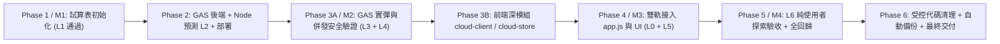

# 隨筆花園（Essay Garden）雲端化開發路線圖

- **基準版本**：`v=20261120l`
- **規格依據**：[database-spec.md](file:///d:/Antigravity%20workspaces/交通美地/database-spec.md)、[verification-spec.md](file:///d:/Antigravity%20workspaces/交通美地/verification-spec.md)
- **目標試算表**：`交通美地-資料庫`（`1UBt7fuHru0fJv1QLStpvaIr2YxIg2vO9sM8yrd-cTAE`）
- **文件目的**：在「完全不破壞現有本機可玩原型」的前提下，透過模組化接縫（Seam）、本地前置驗證、雙軌切換與受控清理，以最低風險分 6 個階段完成 Google Sheets + GAS Web App 雲端化上線。

---

## §1 路線設計原則與順序調整說明

你原本建議的 5 步直覺（先寫模組化介面 → 試算表與 GAS → 雙邊對接測試 → 替換本地儲存 → 清理無用代碼）大方向非常正確。為了讓每一步都有明確的「可測邊界」與「一秒回滾能力」，本路線圖將實作微調為 **Phase 1～Phase 6**（對齊 [verification-spec.md](file:///d:/Antigravity%20workspaces/交通美地/verification-spec.md) 的 `M1～M4` 與 `L0～L6` 閘門）。

### 1.1 原建議順序 vs 調整後順序對照

| 原建議步驟 | 調整後階段 | 調整理由與降風險關鍵 |
| :--- | :--- | :--- |
| 1. 先寫讀寫介面 2. 再處理試算表與 GAS | **Phase 1（試算表初始化）→ Phase 2（GAS 開發＋本地 Node L2 預測＋部署）→ Phase 3A（實彈驗收 L3/L4）→ Phase 3B（前端深模組介面）** | **先穩固後端端點再寫前端接縫**：試算表與 GAS 是真實遠端契約。先在 Phase 2 用本地 Node 模擬消滅 GAS 邏輯錯誤，並在 Phase 3A 用實彈 API 確認 22 個 Action 與併發鎖完全正確，接著才在 Phase 3B 依「已驗證的真實回應格式」打造前端模組，避免邊猜邊改、前後端一起除錯。 |
| 3. 兩邊對接測試 4. 替換本地儲存 | **Phase 4（雙軌接入 `app.js` / `index.html`，保留 `?mode=local`）→ Phase 5（L0～L6 全套驗收含純使用者探索）** | **「唯讀同步、寫入非同步」深模組接縫 + 雙軌 Strangler Fig**：讓 `app.js` 龐大的 2.5D SVG 島嶼渲染與查詢保持同步讀取快取，大幅縮小改動範圍；並保留 `?mode=local` 切換開關做雙軌比對，直到純使用者 `browser` subagent 黑箱探索（L6）零重大缺陷才定案。 |
| 5. 清理無用代碼 | **Phase 6（受控清理與保留清單＋自動備份啟用＋最終回歸）** | **受控清理而非暴力刪除**：明確區分「廢棄示範碼」與「必須保留的 `localStorage` 秒開快取、`engine.js` 純函式與 `createMemoryStorage` 測試契約」，並設定每日自動備份。 |

### 1.2 四項關鍵防風險設計

1. **排錯邊界完全切割**：Phase 1～3 全程**不碰** [index.html](file:///d:/Antigravity%20workspaces/交通美地/index.html)、[app.js](file:///d:/Antigravity%20workspaces/交通美地/app.js) 與 [store.js](file:///d:/Antigravity%20workspaces/交通美地/store.js)；既有 [test_verification.py](file:///d:/Antigravity%20workspaces/交通美地/test_verification.py) 隨時維持 100% 綠燈。
2. **「唯讀同步、寫入非同步」的深模組接縫（Seam）**：將 [store.js](file:///d:/Antigravity%20workspaces/交通美地/store.js) 的介面分為「讀取查詢（同步讀記憶體與快取）」與「狀態變更（寫入雲端）」兩類。所有渲染函式呼叫的 `currentGarden`、`getEvaluatedRegion`、`getCarouselEssays`、`getOrderedRegionsList`、`getPriorityBanner` 等全維持同步回傳，讓 `app.js` 的等距島嶼 SVG 與拖曳縮放手勢幾乎零修改；僅寫入事件改為 `await`。
3. **GAS 部署前先本地預測（L2）**：GAS 手動貼上部署有操作成本，因此在 Phase 2 先以本地 Node 環境注入記憶體版模擬物件跑過規則一致性與全部 22 個 Action 邏輯，大幅降低反覆重新部署試錯的次數。
4. **可逆切換與自動安全鎖**：所有雲端測試嚴守 [verification-spec.md](file:///d:/Antigravity%20workspaces/交通美地/verification-spec.md) §2 隔離與 `try / finally` 清理規則，確保開發驗證結束後試算表零殘留測試資料。

### 1.3 開發總覽流程圖

---

## §2 目標檔案架構與模組邊界（Seam Design）

遵循「小介面、深實作（Deep Module）」與單一職責原則，雲端化新增與調整檔案的邊界劃分如下：

### 2.1 新增檔案清單

| 檔案路徑 | 模組角色 | 對外介面 / 職責 | 相依邊界 |
| :--- | :--- | :--- | :--- |
| `gas/appsscript.json` | GAS 專案清單 | 指定 `V8` 執行環境、開啟進階服務 `Google Sheets API v4`、設定 Web App 權限 | 僅供 GAS 部署 |
| `gas/Code.gs` | GAS 權威後端 | 實作 `doGet`（健康回應）、`doPost`（22 個 Action 分流）、`LockService` 併發鎖、加鹽 SHA-256 密碼雜湊、多裝置永不過期 Session、Sheets `batchGet` 批次讀取、衍生 `userDays`/`groupDays` 彙算、植物懶回寫、防公式注入與每日備份觸發函式 | 共用 [engine.js](file:///d:/Antigravity%20workspaces/交通美地/engine.js) 核心規則邏輯；讀寫目標試算表 |
| `cloud-config.json` | 前端環境設定 | 存放 `mode`（`"cloud"` \| `"local"`）與 `gasWebAppUrl`；**嚴禁放任何密鑰或管理 Token** | 由 `app.js` 啟動時 `fetch` 讀取 |
| `cloud-client.js` | 雲端傳輸深模組 | 封裝單一 `POST (text/plain)` 呼叫、`ping()` 預熱、本機 `essay_garden_session_v1` 讀寫與 `AUTH_INVALID` 事件通知；可注入 `fetchImpl` 與 `storage` 便於測試 | **零 DOM 相依**、不認識遊戲業務邏輯 |
| `cloud-store.js` | 雲端狀態 Adapter | 對外提供與 `GardenStore` 一致的唯讀查詢介面 + 非同步雲端寫入方法；內部封裝 `localStorage` Stale-While-Revalidate 秒開快取、Wait-for-Server 強一致同步與 `setEssayReaction` 樂觀更新／失敗回滾 | 依賴 `cloud-client.js` 與 [engine.js](file:///d:/Antigravity%20workspaces/交通美地/engine.js)；**零 DOM 相依** |
| `test_cloud_verification.py` | 雲端驗收測試套件 | 隨 Phase 1～4 漸進擴充，覆蓋 `L1`、`L2`（Node 對拍）、`L3`、`L4`、`L5`，支援 `--stage m1\|m2\|m3\|all` 與 `--skip-e2e`，內建正式資料安全鎖與 `try/finally` 自動清理 | 獨立測試腳本，不影響既有 [test_verification.py](file:///d:/Antigravity%20workspaces/交通美地/test_verification.py) |

### 2.2 既有檔案改動邊界

| 既有檔案 | Phase 1～3 狀態 | Phase 4～6 調整邊界 |
| :--- | :--- | :--- |
| [engine.js](file:///d:/Antigravity%20workspaces/交通美地/engine.js) | 不改動（已於前置階段完成 `finalLevel` 修復） | 維持純函式無外部相依，供前端與 GAS 共用規則來源 |
| [game-config.json](file:///d:/Antigravity%20workspaces/交通美地/game-config.json) / [catalog.json](file:///d:/Antigravity%20workspaces/交通美地/catalog.json) | 不改動 | 全程維持前端靜態唯讀設定 |
| [store.js](file:///d:/Antigravity%20workspaces/交通美地/store.js) | **完全不動** | Phase 4 維持本機雙軌能力；Phase 6 依「清理／保留清單」精簡，並持續保留 `createMemoryStorage` 測試契約 |
| [index.html](file:///d:/Antigravity%20workspaces/交通美地/index.html) / [app.js](file:///d:/Antigravity%20workspaces/交通美地/app.js) | **完全不動** | 僅在 Phase 4 進行一次性接線：雙軌 Store 切換、寫入 `await` + 防連點、單一帳密彈窗、登出按鈕、`ping` 預熱、`memberDirectory` 查暱稱、座標傳遞與雲端 UI 隔離 |
| [test_verification.py](file:///d:/Antigravity%20workspaces/交通美地/test_verification.py) | **完全不動** | 確保每階段既有 `L0` 四階段測試 100% 維持通過（同步跟隨升級 `ASSET_VER`） |

### 2.3 `GardenStore` 與 `CloudGardenStore` 接縫（Seam）契約

- **同步唯讀方法（維持現狀，`app.js` 渲染無痛複用）**：
  `nowMs()`、`currentGarden()`、`currentDayKey()`、`currentUser()`、`getCurrentUserMultiplier()`、`getDecorBeautyBonus()`、`getGroupGrowthMultiplier()`、`getEvaluatedRegion()`、`getCarouselEssays()`、`canMakeUpYesterday()`、`hasStreakBrokenYesterday()`、`canRescuePlantByMakeUp()`、`isCellOccupied()`、`getOrderedRegionsList()`、`getPriorityBanner()`、`getMemberDisplayName(uid)`（新增共用查名介面，雲端查 `memberDirectory`、本機查 `garden.members`）。
- **非同步狀態變更方法（`app.js` 統一以 `await` 呼叫，同時相容同步與 `Promise`）**：
  `initSession()` / `authenticate(username, password)` / `logout()` / `syncBootstrap()` / `ensureEssayMonthLoaded(month)` / `ping()` / `updateDisplayName()` / `submitEssay()` / `updateEssayContent()` / `setEssayReaction()` / `makeUpYesterday()` / `plantSeed()` / `clearDeadPlant()` / `buyAndPlaceDecor()` / `removeDecor()` / `moveGridItem()` / `decomposeSeed()` / `expandActiveRegion()` / `createGroupGarden()` / `joinGroupByCode()` / `leaveGroupGarden()` / `castGroupThemeVote()` / `startNewMonthRegion()`。

---

## §3 分階段詳細開發步驟與驗收閘門（Phase 1～Phase 6）

### Phase 1（對應 M1）：試算表格式化初始化 ＋ 驗收起手式

- **目標**：將空白試算表 `交通美地-資料庫` 建立為嚴格對齊 [database-spec.md](file:///d:/Antigravity%20workspaces/交通美地/database-spec.md) §3 的 4 張純文字安全表結構。
- **既有系統影響**：**零影響**（不修改任何前端、設定或測試碼）。
- **具體交付**：
  1. 透過 Service Account (`gsheet_io` + Google Sheets API v4) 初始化試算表 `1UBt7fuHru0fJv1QLStpvaIr2YxIg2vO9sM8yrd-cTAE`：
     - 建立 `users`（21 欄）、`groups`（13 欄）、`gardens`（12 欄）、`essays`（`A1 = day_key`）並寫入第 1 列精確欄位名，凍結第 1 列。
     - 對 [verification-spec.md](file:///d:/Antigravity%20workspaces/交通美地/verification-spec.md) `TC-S03` 所列全部字串／日期／JSON 欄位及整張 `essays` 工作表預先套用純文字格式（`numberFormat.type = "TEXT"`, `pattern = "@"`）。
     - 移除原本空白的預設 `工作表1`。
  2. 建立 `test_cloud_verification.py` 基礎版（`--stage m1`），實作 `L1` 白箱檢查與「偵測非 `u_test_*` 資料即中止」之安全鎖。
- **退出閘門**：`test_cloud_verification.py --stage m1` 通過 **`L1 (TC-S01`～`TC-S03)`**。
- **失敗回滾**：重跑初始化或還原為空白 `工作表1`，對既有前端零影響。

---

### Phase 2：GAS 後端開發 ＋ 本地 Node L2 預測 ＋ Web App 部署

- **目標**：完成所有後端業務邏輯並通過本地確定性測試後，一次部署成可呼叫的 GAS Web App。
- **既有系統影響**：**零影響**。
- **具體交付**：
  1. 產出 `gas/appsscript.json`（啟用 `Sheets` v4 進階服務、V8 runtime、設定 Web App 存取權限）與 `gas/Code.gs`：
     - 核心運算邏輯直接對齊 [engine.js](file:///d:/Antigravity%20workspaces/交通美地/engine.js)（字數、機率、連勝修復、植物惰性結算、美觀度、投票雜湊）。
     - 實作全部 **22 個 Action**（`ping`、`auth`、`logout`、`bootstrap`、`getEssaysByMonth` 及 17 個寫入／互動 Action）。
     - 實作 `LockService.getScriptLock().tryLock(10000)` 互斥鎖、密碼加鹽迭代 SHA-256（`s256$<salt>$<hex>`）、多裝置永不過期 `session_hashes_json`、Sheets API `batchGet`、`userDays`/`groupDays` 動態彙算、植物 `grown` / 連缺 ≥ 3 天 `dead` 懶回寫（含 `finalLevel`）、防公式注入與 `RAW` 模式寫入、單格 49,000 字元檢查。
  2. **本地 Node L2 預測**：在部署到 Google 之前，先於本地用 Node 載入並模擬 `SpreadsheetApp`/`Sheets`/`LockService` 執行 **`L2 (TC-S05)`**（與 `engine.js` 逐題對拍）及全 22 個 Action 核心流程，將邏輯 bug 消滅在本地。
  3. **人機協作部署（人工節點 #2）**：
     - 開啟 `交通美地-資料庫` 試算表 → 點選「擴充功能 → Apps Script」。
     - 貼入 `gas/Code.gs`（並於「專案設定 → 顯示 appsscript.json」貼入 `gas/appsscript.json` 確認啟用 `Google Sheets API` 服務）。
     - 點選「部署 → 新增部署作業 → 類型選『網頁應用程式』」，設定「執行身分：**我**」、「誰可以存取：**任何人**」，完成授權並取得 `GAS_WEBAPP_URL`。
     - 將 `GAS_WEBAPP_URL` 填入設定檔 `cloud-config.json`（可先設 `mode: "local"`，讓現有網頁在尚未接線前完全不受影響）。
- **退出閘門**：**`L2 (TC-S05)`** 本地對拍 100% 通過 ＋ 實彈 **`TC-S06`**（`ping` 免 `OPTIONS` 預檢成功且時間誤差 `< 10s`）。
- **失敗回滾**：僅修改 `gas/Code.gs` 並更新 GAS 部署版本即可，前端與既有資料完全無影響。

---

### Phase 3（對應 M2）：後端實彈全驗證 ＋ 前端深模組開發

拆分為平行或先後兩小步，仍然**不碰**既有 `app.js` / `store.js`：

- **Phase 3A：GAS 實彈功能、併發與安全性全驗證**
  - 擴充 `test_cloud_verification.py --stage m2`，針對真實 `GAS_WEBAPP_URL` 執行完整端到端 API 與 `gsheet_io` 白箱核對。
  - **退出閘門**：**`L3 (TC-A01`～`TC-A26)`** 與 **`L4 (TC-R01`～`TC-R10)`**（含 5 執行緒併發搶種子、佔格競爭、同帳號併發註冊去重、日期防轉型、公式注入、隱私滲透與越權測試）100% 通過；`try / finally` 清理後確認試算表零測試殘留。
- **Phase 3B：前端通訊與狀態深模組開發**
  - 撰寫 `cloud-client.js`（單一 `POST text/plain`、自動帶 `essay_garden_session_v1`、`ping`、`AUTH_INVALID` 處理與可注入 `fetch`）。
  - 撰寫 `cloud-store.js`（`CloudGardenStore`：實作 §2.3 全部唯讀／非同步契約、`localStorage` 快取、Strong-Consistency 等待與 `setEssayReaction` 樂觀更新／失敗回滾、懶載入歷史月份隨筆整合）。
  - 使用本地 Node 或 Playwright unit page 搭配 mock `fetch` 與真實 `GAS` 回應格式驗證 `CloudGardenStore` 所有方法與快取回復行為。
  - **退出閘門**：`CloudGardenStore` 單元／契約測試通過，且 [test_verification.py](file:///d:/Antigravity%20workspaces/交通美地/test_verification.py) 維持 100% 綠燈。
- **失敗回滾**：Phase 3A/3B 全在新增檔案中進行，隨時修正後端或 `cloud-*.js` 即可，既有應用 0 風險。

---

### Phase 4（對應 M3）：雙軌接入前端 `app.js` / `index.html`

- **目標**：透過乾淨接縫讓前端接上雲端模式，同時保留 `?mode=local` 作為一秒切換的保險絲。
- **既有系統影響**：**雙軌並存**（預設依 `cloud-config.json` 啟動；加上 `?mode=local` 參數即可立即切回原本純本機 `GardenStore`）。
- **具體交付**：
  1. **雙軌啟動切換**：[app.js](file:///d:/Antigravity%20workspaces/交通美地/app.js) `boot()` 讀取 `cloud-config.json`（並檢查 URL `?mode=local`）決定建立 `CloudGardenStore` 或 `GardenStore`。
  2. **單一帳密彈窗與永不過期 Session**：首訪無 `essay_garden_session_v1` 時顯示「進入隨筆花園」單一帳密彈窗（無獨立註冊頁／切換分頁）；成功後寫入永不過期 token 並進入主畫面；設定頁新增「登出帳號」按鈕呼叫 `logout`。
  3. **非同步互動與防連點**：寫入操作按鈕（寫隨筆、補寫、種植、購買裝飾、擴地、開／加／退團、換月選主題）改為 `await` 並於進行中鎖定按鈕防連點；`setReaction` 走樂觀更新與失敗自動回滾。
  4. **細節對齊 [database-spec.md](file:///d:/Antigravity%20workspaces/交通美地/database-spec.md) §7（第 2～8 點）**：
     - 開啟寫作彈窗時背景靜默觸發 `store.ping()` 預熱（失敗不報錯）。
     - `plant_detail` 與隨筆作者統一透過 `getMemberDisplayName(uid)` 查詢 `memberDirectory`。
     - `updateEssayContent` 與 `setEssayReaction` 傳入 `dayKey` 與 `authorUid`。
     - `bootstrap` 完成後同步 `user.lastCardStyle` 到 `essay_garden_card_style_v1`。
     - 雲端模式隱藏「時間推進模擬器」、「+200 測試能量」、「重置初始示範資料」與「模擬圈友寫一篇」。
     - 切換「所有隨筆頁」翻閱更早月份時，隨需呼叫 `ensureEssayMonthLoaded(month)`。
  5. 同步更新 `ASSET_VER` 並擴充 `test_cloud_verification.py --stage m3` 涵蓋全部 `L5` E2E 測試。
- **退出閘門**：**`L0 (TC-S04)` + `L5 (TC-E01`～`TC-E09)`**（含 Mobile/WebKit 零 `OPTIONS`、零跨網域 `iframe`、雙裝置同步、斷網韌性）100% 通過。
- **失敗回滾**：將 `cloud-config.json` 的 `mode` 改回 `"local"`（或網址加上 `?mode=local`），瞬間退回純本機版本。

---

### Phase 5（對應 M4）：全環境總回歸 ＋ L6 純使用者探索式驗收

- **目標**：由完全不了解實作細節的第三方視角實測真實使用體驗，並重跑全套 L0～L6 驗收門檻。
- **既有系統影響**：僅針對探索發現之缺陷進行針對性修復。
- **具體交付**：
  1. **L6 純使用者探索驗收**：依 [verification-spec.md](file:///d:/Antigravity%20workspaces/交通美地/verification-spec.md) §7 黑箱規範派發獨立 `browser` subagent，僅提供網站 URL 與帳號前綴 `u_test_uat_*`，執行 **`TC-U01`～`TC-U03`**（單人全流程、雙人小圈子互動、手機直式非常規操作）。
  2. **缺陷修復與回歸固化**：修正 subagent 回報之所有 `Blocker` 與 `Major` 缺陷，將問題場景補為自動化回歸斷言，並重新派發 `browser` subagent 複測至 **`Blocker = 0, Major = 0`**；`Minor` UX 建議整理呈現給使用者評估。
  3. **全套回歸**：執行 `test_cloud_verification.py --stage all` 加上 [test_verification.py](file:///d:/Antigravity%20workspaces/交通美地/test_verification.py)，確認 **54 項測試案例**、延遲指標與 `try / finally` 清理後試算表潔淨度全數達標。
- **退出閘門**：達成 [verification-spec.md](file:///d:/Antigravity%20workspaces/交通美地/verification-spec.md) §1.3 全部 Go / No-Go 放行門檻。

---

### Phase 6：受控代碼清理、自動備份與正式交付

- **目標**：安全移除過渡期殘留碼，啟用正式試算表每日備份，完成最終交付。
- **明確清理與保留邊界**（先經人工節點 #3 確認範圍後執行）：

| 分類 | 具體項目 | 處置方式與原因 |
| :--- | :--- | :--- |
| **應清理項目** | [store.js#L1](file:///d:/Antigravity%20workspaces/交通美地/store.js#L1) 過時的「Firebase 雲端同步」註解 | 改寫為符合實際 GAS + Google Sheets 雲端架構之註解 |
| **應清理項目** | 雲端路徑下不可達或僅供原型假體驗的 `user_friend_1`、`simulateTeammateWrite()` 與過渡雙軌旗標（若確認不再保留純本機示範模式） | 依使用者於節點 #3 決定：若完全下線本機示範模式，則連同移除 `store.js` 中的示範狀態／模擬時間偏移碼，並同步清理 `test_verification.py` 對應測項；若保留 `?mode=local` 離線展示模式，則維持隔離不動 |
| **必須保留項目** | `localStorage` 快取（`essay_garden_state_v4`、`essay_garden_session_v1`、`essay_garden_card_style_v1`） | 支撐首屏 `< 300ms` 秒開與離線閱讀韌性，不可誤刪 |
| **必須保留項目** | [engine.js](file:///d:/Antigravity%20workspaces/交通美地/engine.js) 全部純函式與 [store.js](file:///d:/Antigravity%20workspaces/交通美地/store.js) `createMemoryStorage` | 核心遊戲計算引擎與無瀏覽器依賴的記憶體測試契約 |
| **必須保留項目** | [test_verification.py](file:///d:/Antigravity%20workspaces/交通美地/test_verification.py) 與 `test_cloud_verification.py` | 作為後續新增功能的長期回歸防護網 |

- **正式維運啟用**：於 GAS 設定每日凌晨 03:30 定時備份觸發器（`DriveApp` 複製試算表至備份資料夾並保留 14 日滾動備份＋每月 1 號快照，對應 [database-spec.md](file:///d:/Antigravity%20workspaces/交通美地/database-spec.md) §8.2）。
- **最終驗收**：清理完成並設定好備份後，最後執行一次 **L0～L5 全套驗證**，確認全數通過且 `交通美地-資料庫` 僅存乾淨的 4 張空表頭準備迎接入駐真實資料。

---

## §4 風險控管與回滾機制矩陣

| 潛在風險 | 影響程度 | 預防措施（已內建於路線） | 發生時回滾方式 |
| :--- | :---: | :--- | :--- |
| **GAS 部署後才發現大量邏輯錯，反覆人工貼上重部署** | 中 | Phase 2 強制先在本地 Node 以模擬表跑通 L2 與全部 22 個 Action，過測再進行人工部署 | 僅需更新 GAS 程式碼部署新版，前端無感 |
| **非同步改動破壞原本手機縮放／拖曳／長按反應互動** | 高 | 採「唯讀同步、寫入非同步」接縫；`app.js` 渲染與指標手勢完全沿用既有同步結構，且雙軌保留 `?mode=local` | 切換 `cloud-config.json` 回 `"local"` 一秒復原，逐步比對修正 |
| **前後端計算規則（字數、植物等級、抽獎）不同步** | 高 | Phase 2 強制執行 L2 (`TC-S05`) 雙邊輸出對拍測試，GAS 核心與 `engine.js` 同源 | 修正單一實作並立即重跑 L2 對拍 |
| **自動化或探索測試誤汙染正式使用者試算表** | 極高 | `test_cloud_verification.py` 內建正式資料檢查鎖（遇非 `u_test_*` 即拒絕執行）＋ `try/finally` 自動清理；上線後測試只連獨立副本 `TEST_SHEET_ID` | 若已發生誤寫，立即從每日 03:30 Google Drive 備份還原 |
| **Phase 6 過度清理誤刪快取或破壞 `test_verification.py`** | 中 | 事先明確列出清理與保留白名單，且清理後必須重跑完整回歸驗證才算結案 | 透過 Git 還原誤刪程式段並重跑測試 |

---

## §5 執行節奏與人工確認節點（Checkpoints）

整個開發流程可高度自動化推進，僅需你在以下 **3 個明確節點** 確認或協助即可：

| 節點 | 時機點 | 需要你確認／執行的事項 | 完成後立刻進入 |
| :--- | :--- | :--- | :--- |
| **Checkpoint 1（現在）** | 審閱本路線圖後 | 確認本路線圖與順序無誤，授權動工 | **Phase 1**：初始化 `交通美地-資料庫` 4 張工作表，並產出 **Phase 2** GAS 程式碼與完成本地預測 |
| **Checkpoint 2** | Phase 2 完成本地預測後 | 依操作指引將 `gas/Code.gs` 與 `gas/appsscript.json` 貼入試算表 Apps Script、啟用 `Google Sheets API` 服務並部署為網頁應用程式，將取得的 `GAS_WEBAPP_URL` 交給我 | **Phase 3A/3B → Phase 4 → Phase 5**：自動跑完實彈 L3/L4、前端接線 L5 與 L6 純使用者探索並整理報告 |
| **Checkpoint 3** | Phase 5 產出 L6 報告後 | 檢視 L6 純使用者體驗中的 `Minor` 建議是否一併優化，並決定 Phase 6 是否保留 `?mode=local` 離線展示模式 | **Phase 6**：執行受控清理、啟用每日備份並完成最終上線總驗收 |
