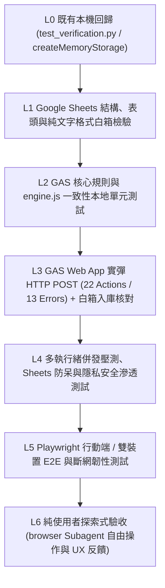

# 隨筆花園（Essay Garden）雲端資料庫驗收標準與完整測試規格書

## §1 測試目標、環境綁定與放行門檻（Go / No-Go Criteria）

- **規格依據**：[database-spec.md](file:///d:/Antigravity%20workspaces/交通美地/database-spec.md)（盤點基準 `v=20261120l`）
- **文件用途**：規範從純本機 `localStorage` 原型遷移至 **Google Sheets ＋ GAS Web App (`fetch POST`)** 過程中，每一階段必須通過的自動化驗收標準與測試案例設計。正式開發前先鎖定驗收基準，後續實作一律以本文件為準。

### 1.1 已驗證連通之目標試算表環境

| 項目 | 規格值 | 驗證工具與備註 |
| :--- | :--- | :--- |
| **試算表名稱** | `交通美地-資料庫` | 唯讀 `get_sheet_info` 已驗證連通 |
| **Spreadsheet ID** | `1UBt7fuHru0fJv1QLStpvaIr2YxIg2vO9sM8yrd-cTAE` | 已共用給 Service Account (`service-account@antigravity-ai-tool.iam.gserviceaccount.com`) |
| **網址** | `https://docs.google.com/spreadsheets/d/1UBt7fuHru0fJv1QLStpvaIr2YxIg2vO9sM8yrd-cTAE` | 開發前初始狀態僅含空白 `工作表1`（1000×26） |
| **白箱檢驗通道** | `C:\Users\wl020\.gemini\config\mcp_servers\gsheet_io.py` + Google Sheets API v4 | 不經 GAS 直接核對試算表工作表、表頭、儲存格格式與實際寫入內容 |
| **GAS 端點** | `GAS_WEBAPP_URL`（於 M2 部署後填入環境設定） | 一律採 `POST` + `Content-Type: text/plain;charset=utf-8` 呼叫，覆蓋 `ping`、`auth`、`logout` 與其餘 19 個業務 Action（共 22 個 Action） |

### 1.2 七層驗證金字塔（L0～L6）

- **L0 既有本機回歸**：確保雲端改造不破壞離線記憶體模式、靜態契約（[game-config.json](file:///d:/Antigravity%20workspaces/交通美地/game-config.json) / [catalog.json](file:///d:/Antigravity%20workspaces/交通美地/catalog.json) / 圖片尺寸與 `ASSET_VER`）及既有 `createMemoryStorage` 介面（[test_verification.py](file:///d:/Antigravity%20workspaces/交通美地/test_verification.py)）。
- **L1 試算表結構白箱**：不經過 GAS，直接透過 Sheets API 驗證工作表清單、欄位精確順序與純文字 `@` 格式設定。
- **L2 規則核心一致性**：在 Node 環境對 GAS 共用規則邏輯與 [engine.js](file:///d:/Antigravity%20workspaces/交通美地/engine.js) 進行輸入／輸出對拍，防止前後端計算出現任何 1 位元誤差。
- **L3 實彈 API 與雙重驗證**：對已部署的 GAS Web App 發送真實 HTTPS POST 請求；每個成功或失敗的請求除了驗證 HTTP JSON 回應，**必須同步以 `gsheet_io` 直接讀取試算表確認底層列／格完全符合預期**。
- **L4 防呆、併發與安全性**：驗證日期不轉型、公式不執行、單格不超限、`LockService` 競態零掉單／零重覆、跨帳號零隱私洩漏。
- **L5 真實瀏覽器 E2E**：以 Playwright（包含 Mobile / WebKit 模式與雙 `BrowserContext`）驗證首屏秒開、帳密合一入口與永不過期 Session、撰寫預熱 `ping`、防連點、樂觀更新回滾、零 `OPTIONS` 預檢、零跨網域 `<iframe>` 與離線降級。
- **L6 純使用者探索式驗收**：派發獨立 `browser` subagent，在不接觸程式碼與操作腳本的純黑箱前提下，以真實玩家身分自由試用全部功能與邊界情境，發掘工程測試難以涵蓋的流程卡點與 UX 問題。

### 1.3 量化放行門檻（Release Gate）

上線前必須**同時滿足**以下全部門檻，任一未達標即判定不放行（No-Go）：

| 門檻維度 | 驗收標準 |
| :--- | :--- |
| **功能正確性** | P0 測試案例通過率 **100%**；P1 案例通過率 **100%**；既有 [test_verification.py](file:///d:/Antigravity%20workspaces/交通美地/test_verification.py) `[1/4]`～`[4/4]` **100% 通過** |
| **探索式使用者驗收（L6）** | `browser` subagent 以純使用者角度完成自由探索，**Blocker = 0、Major = 0**（發現即修並重新派發複測通過），Minor UX 反饋彙整回報 |
| **前端執行穩定度** | Playwright 全流程 **0 個 `pageerror`**、**0 個未預期 `console.error`**、**0 次失敗網路請求**（斷網與回滾模擬測試除外） |
| **傳輸與相容性** | **0 次 CORS `OPTIONS` 預檢請求**、**0 顆跨網域 GAS `<iframe>`**、Safari / WebKit 封鎖第三方 Cookie 情境下 100% 正常 |
| **前端啟動體感** | 有本機快取時 `localStorage` 首屏渲染 **< 300 ms**（不等待 GAS 回應即完成首繪） |
| **GAS API 溫熱延遲** | `ping` **< 1.0 s**；`bootstrap` / `auth`（≤ 5 人、近 2 個月）**< 2.5 s**；一般寫入 Action **< 2.0 s**（冷啟動首次請求放寬至 **< 6.0 s**） |
| **測試後環境潔淨度** | teardown 完成後，`users` / `groups` / `gardens` / `essays` **零殘留任何 `u_test_*`、`grp_test_*`、`g_test_*` 測試列或測試欄** |

---

## §2 測試資料隔離、時間控制與清理規範

### 2.1 測試資料隔離規範

1. **開發驗證期（試算表尚未存有真實使用者資料）**
   - 所有自動化測試建立的帳號、團體、花園、隨筆一律使用固定測試前綴：
     - 使用者 `uid`：`u_test_*`
     - 團體 `group_id`：`grp_test_*`
     - 花園 `garden_id`：`g_test_*`（快照 `snap_test_*`）
     - 隨筆 `essayId`：`e_*`（位於 `u_test_*` 所屬直欄）
   - 測試腳本啟動時須先檢查 `users` 表是否已存在非 `u_test_*` 的正式資料：
     - **若完全無正式資料**：允許對綁定試算表執行全套自動化測試；執行完畢後無論成功或失敗，**必須在 `try / finally` 區塊執行自動 Teardown**，移除所有測試列、移除 `essays` 第 1 列與所有列中的 `u_test_*` 直欄，並清除僅由測試寫入的純空白日期列。
     - **若已存在任何正式使用者資料**：腳本必須**立即中止並拒絕寫入**，強制要求改用環境變數 `TEST_GAS_URL` 與 `TEST_SHEET_ID` 指向獨立的測試副本，嚴禁汙染正式資料庫。
2. **上線維運期（已有正式資料後）**
   - 任何回歸測試只允許針對獨立複製的 `TEST_SHEET_ID` + `TEST_GAS_URL` 執行，不可對正式試算表跑寫入性測試；對正式環境僅允許唯讀的 `ping` 健康檢查與表結構巡檢（`TC-S01`～`TC-S03`）。

### 2.2 時間敏感案例的可測性規範（禁止後門）

本遊戲包含「凌晨 04:00 換日」、「連缺 1 天枯萎／2 天可救／3 天不可逆死亡」、「月底最後一天投票／跨月換島」等時間敏感機制。為確保安全性同時兼顧實彈可測性，採用分層控制：

- **L2（本地核心單元測試）**：直接對規則函式注入 `nowMs` 參數（對應不同 UTC / IANA 時區時間戳）進行全時點確定性測試。
- **L3（GAS 實彈整合測試）**：**不在正式 GAS 程式碼保留「由前端指定假時間」的作弊參數或後門**；改由 Python 測試腳本先取得 GAS 當下的 `serverTimeMs` 與 `todayKey`，透過 **`gsheet_io` 白箱直接寫入或修改 `u_test_*` 測試帳號的歷史日期資料**（例如把植物 `plantedDay` 設為 `todayKey - 3`、把 `gardens.month` 設為上個月、`essays` 寫入 `todayKey - 1/-2`），再呼叫真實 GAS API（`bootstrap`、`makeUpYesterday`、`castThemeVote` 等）驗證伺服器在真實時鐘下的計算、懶回寫與換月定案是否 100% 正確。

---

## §3 L0 & L1：靜態契約與試算表結構檢驗（`TC-S01`～`TC-S06`）

| 編號 | 優先級 | 層級 | 檢驗項目 | 檢驗方式與具體通過標準 |
| :--- | :---: | :---: | :--- | :--- |
| `TC-S01` | P0 | L1 | 工作表清單完整性 | 透過 `get_sheet_info` 確認試算表僅存在且精確命名為 `users`、`groups`、`gardens`、`essays` 4 張工作表；預設空白的 `工作表1` 必須已移除或更名。 |
| `TC-S02` | P0 | L1 | 4 表欄位名稱與順序 | 讀取每張表第 1 列（1-indexed）並比對完全相等： 1. `users`（21 欄）：`uid, username, password_hash, session_hashes_json, display_name, timezone, active_group_id, energy, pity, streak_count, streak_last_day, streak_prev_count, streak_prev_last_day, seeds_json, limited_seeds_json, milestones_json, dex_json, last_card_style, makeup_days_json, created_at, updated_at` 2. `groups`（13 欄）：`group_id, name, owner_uid, status, invite_code, member_uids_json, former_member_uids_json, timezone, theme_vote_month, theme_votes_json, makeup_days_json, created_at, updated_at` 3. `gardens`（12 欄）：`garden_id, owner_type, owner_id, month, theme, status, snapshot_name, size, expansions, items_json, created_at, updated_at` 4. `essays`：第 1 列 `A1 === "day_key"`，其右側欄位依序為各使用者 `uid`。 |
| `TC-S03` | P0 | L1 | 純文字 (`@`) 與數值格式預配置 | 以 Sheets API `spreadsheets.get(includeGridData=true)` 檢查關鍵欄預設儲存格格式為 `numberFormat.type === "TEXT"`（`pattern === "@"`）： - `users`：`uid`, `username`, `password_hash`, `session_hashes_json`, `display_name`, `timezone`, `active_group_id`, `streak_last_day`, `streak_prev_last_day`, `seeds_json`, `limited_seeds_json`, `milestones_json`, `dex_json`, `last_card_style`, `makeup_days_json` - `groups`：`group_id`, `name`, `owner_uid`, `status`, `invite_code`, `member_uids_json`, `former_member_uids_json`, `timezone`, `theme_vote_month`, `theme_votes_json`, `makeup_days_json` - `gardens`：`garden_id`, `owner_type`, `owner_id`, `month`, `theme`, `status`, `snapshot_name`, `items_json` - `essays`：整張表（包含 A 欄 `day_key` 與所有 `uid` 直欄）。 |
| `TC-S04` | P0 | L0 | 既有本機回歸契約 | 執行 [test_verification.py](file:///d:/Antigravity%20workspaces/交通美地/test_verification.py) 必須輸出 `ALL_ENGINE_AND_ARCHITECTURE_CONTRACTS_PASSED` 且 exit code = 0，確認 46 種植物／6 種裝飾／15 張島嶼圖、`createMemoryStorage` 與 `ASSET_VER` 一致性未遭破壞。 |
| `TC-S05` | P0 | L2 | GAS 共用規則與 [engine.js](file:///d:/Antigravity%20workspaces/交通美地/engine.js) 一致性 | 於 Node 同時載入 GAS 共用核心與前端 `engine.js`，針對相同測資（中英混排字數、10～150 字稀有度機率、多人天數進位、Lv1～Lv5 與枯萎復活／死亡邊界、`resolveGroupThemeVote` 含平票與無人投票雜湊）比對輸出 100% 相等；包含 `finalStage: 'dead'` + `finalLevel` 測試。 |
| `TC-S06` | P0 | L3 | HTTP POST / `text/plain` 連通性與時間校準 | 以 `POST` + `Content-Type: text/plain;charset=utf-8` 呼叫 `action: "ping"`（追蹤 GAS 302 重導向）：確認不發送 `OPTIONS` 即可取得 HTTP 200 JSON `{ ok: true, serverTimeMs }`，且 `|serverTimeMs - utcNowMs| < 10_000`。 |

---

## §4 L2 & L3：全部 22 個 Action 功能與白箱入庫測試矩陣（`TC-A01`～`TC-A26`）

> 除明確標註失敗案例外，每筆成功案例均須執行 **雙重驗證**：① API 回傳 `{ ok: true, serverTimeMs, data }` 結構與數值正確；② 直接透過 `gsheet_io` 讀取試算表底層儲存格確認真實落盤結果正確。

### 4.1 連線、身分驗證與帳號主檔

| 編號 | 優先 | Action | 前置條件與輸入 | API 預期回應 | 白箱試算表驗證點 |
| :--- | :---: | :--- | :--- | :--- | :--- |
| `TC-A01` | P0 | `ping` | 合法請求 `{ action: "ping", authToken: "", payload: {} }` | `ok: true`，含數值型 `serverTimeMs`；溫熱耗時 `< 1.0s` | 不讀寫任何工作表 |
| `TC-A02` | P0 | `auth`（首次自動建帳 ＋ 重複帳號視為登入 ＋ 密碼錯誤 ＋ 格式驗證） | (a) 不存在帳號 `u_test_alpha` + 合法密碼 (b) 同帳號大小寫變體 `U_TEST_ALPHA` + 同密碼（模擬第 2 裝置） (c) 同帳號 + 錯誤密碼 (d) 帳號含空白／`< 2` 字／`> 24` 字或密碼 `< 4` 字 | (a) `ok: true`, `isNewUser: true`，回傳 `sessionToken_1` 與完整 `bootstrap`（`energy: 65`, `pity: 0`, `activeGroupId: ""`、當月 `5×5` 個人 `gardens`） (b) `ok: true`, `isNewUser: false`，核發新 `sessionToken_2` (c) `ok: false`, `code: "AUTH_INVALID"`（明確提示帳號已存在、密碼錯誤） (d) `ok: false`, `code: "VALIDATION_ERROR"` | (a) `users` 新增 **1 列**、`password_hash` 為 `s256$...`（非明文）、`session_hashes_json` 存雜湊（非明文）、`essays` 第 1 列最右側新增 **1 欄** `uid`、`gardens` 建 `5×5` 島 (b) 不重複建帳不重複增欄，`session_hashes_json` 同時保留裝置 1 與裝置 2 的雜湊（多裝置不互踢） (c)(d) 試算表 0 變動 |
| `TC-A03` | P0 | `logout` 與永不過期 Session 生命週期 | (a) 無 token 或偽造 token 呼叫 `bootstrap` (b) 裝置 1 (`sessionToken_1`) 與裝置 2 (`sessionToken_2`) 皆呼叫 `bootstrap` (c) 對裝置 1 呼叫 `logout` 後，分別以 `sessionToken_1` 與 `sessionToken_2` 再呼叫 `bootstrap` | (a) `AUTH_INVALID` (b) 兩者皆 `ok: true` (c) `logout` 回 `{ loggedOut: true }`；隨後 `sessionToken_1` 呼叫 `bootstrap` 回 `AUTH_INVALID`，但 **`sessionToken_2` 仍永久有效** | 白箱確認 `users.session_hashes_json` 僅移除裝置 1 之雜湊，裝置 2 雜湊完整保留 |
| `TC-A04` | P1 | `updateDisplayName` | (a) `displayName: "  晨光旅人  "` (b) `displayName: "   "`（全空白） (c) 超過 30 字元 | (a) `ok: true`，回傳 trim 後 `"晨光旅人"` (b)(c) `ok: false`, `code: "VALIDATION_ERROR"` | (a) `users.display_name` 為 `"晨光旅人"`；隨後呼叫 `bootstrap` 確認 `memberDirectory["u_test_1"] === "晨光旅人"` |

### 4.2 隨筆寫作、編輯、反應與換日計算

| 編號 | 優先 | Action | 前置條件與輸入 | API 預期回應 | 白箱試算表驗證點 |
| :--- | :---: | :--- | :--- | :--- | :--- |
| `TC-A05` | P0 | `submitEssay`（基本規則、上限與滿袋分解） | 依序送出： (a) 9 字短文 (b) 個人第 1～3 篇（≥ 10 字） (c) 個人第 4 篇（55 字） (d) 將測試帳號 `seeds_json` 白箱設為滿 30 顆（另一日再寫第 1 篇） | (a) `VALIDATION_ERROR` (b) 前 3 篇皆抽中種子（首篇發基礎能量 `10` 且 `streakCount` 進階）；第 4 篇 `rewardType: "energy"`、`overflowEnergy: 5` (d) `rewardType: "seed_decomposed"`、發分解能量且不超 30 顆 | `essays` 對應 `(dayKey, uid)` 格內陣列長度與 `wordCount` 精準；單篇 JSON **不含** `authorName` 與 `authorUid` 冗餘鍵；(d) 該篇 `reward.type === "seed"`（仍占當日種子額度） |
| `TC-A06` | P0 | `submitEssay`（保底 `pity` 與里程碑限定種子） | 白箱預置 `u_test_1`：`pity = 10`；另一測試將 `streak_count = 6` 且 `streak_last_day = yesterdayKey` | 保底第 11 顆必出 `epic` 或 `legendary` 且 `user.pity` 歸 `0`；連寫第 7 天解鎖 `lim_7` 進 `limitedSeeds`、`milestones` 加入 `7`、圖鑑解鎖 `lim_7`（再補寫／同日寫第 2 篇不重複發放） | `users.pity === 0`、`milestones_json === "[7]"`、`limited_seeds_json` 含 `"lim_7":1`、`dex_json` 含 `"lim_7"` |
| `TC-A07` | P0 | `updateEssay` | (a) 作者修改內容、字數、隱私與 `cardStyle` (b) 清空內容為 `"..."`（0 有效字） (c) `u_test_2` 嘗試修改 `u_test_1` 隨筆 | (a) `ok: true`，更新 `wordCount` 與 `updatedAt`，**不重算/不發新獎勵**，`userDays[dayKey].words` 同步更新 (b) `VALIDATION_ERROR` (c) `FORBIDDEN` | `essays` 該單格內目標物件 `content`/`wordCount`/`cardStyle` 已更新且 `reward` 完全不變；`users.last_card_style` 與 `energy`/`seeds` 未被重複發放 |
| `TC-A08` | P0 | `setReaction` | (a) 個人模式 `private: true` 本人點 `'love'` 再傳 `null` 取消 (b) 團體公開隨筆由 `u_test_1` 點 `'sparkle'`、`u_test_2` 點 `'hug'` (c) 團體 `private: true` 隨筆由作者或團員點反應 (d) 傳入非法 `'angry'` | (a) 個人私密隨筆允許按與取消 (b) `reactions` 同時保留 `{"u_test_1":"sparkle","u_test_2":"hug"}` 互不覆蓋 (c) `FORBIDDEN` (d) `VALIDATION_ERROR` | `essays` 該格內 `reactions` 欄位與實際結果完全相符 |
| `TC-A09` | P1 | `getEssaysByMonth` | 白箱在 `essays` 寫入 4 個月前的本人隨筆及同團成員公開／私密隨筆 | 只回傳該目標月份隨筆，含本人全部 + 當前團員 `private: false`，不含前個月與他人 `private: true` | 與試算表歷史列逐筆吻合 |
| `TC-A10` | P0 | `submitEssay`（04:00 換日與跨時區 A 欄定位） | 設定 `u_test_tz1`（`Asia/Taipei`）與 `u_test_tz2`（`America/Los_Angeles`）於台北時間 `03:55`～`04:05` 或跨時區時段寫作；另在 `essays` A 欄預置非單調順序日期列 | 依 `dayBoundaryHour: 4` 正確歸屬前一日或當日；跨時區兩人在不同 `dayKey` 寫入皆成功定位不覆蓋 | `essays` A 欄各自寫入正確 `YYYY-MM-DD` 列；不會因 A 欄非嚴格遞增而寫錯列 |
| `TC-A11` | P1 | 個人與團體種子額度獨立性 | 個人模式當天已寫 3 篇領滿 3 顆種子，隨後執行 `createGroup` | 進團後當日 `groupDays[todayKey].seedsGiven === 0`，在團體內當天寫作可再領團體每日 3 顆種子額度 | `essays` 中 `groupId === ""` 與 `groupId === grpId` 各自正確標記且衍生統計互不汙染 |

### 4.3 補寫機制、植物惰性結算與懶回寫

| 編號 | 優先 | Action | 前置條件與輸入 | API 預期回應 | 白箱試算表驗證點 |
| :--- | :---: | :--- | :--- | :--- | :--- |
| `TC-A12` | P0 | `makeUpYesterday` | (a) 個人昨天無紀錄、能量 `65` (b) 團體內昨天無紀錄、能量 `65` (c) 同日重複補寫第 2 次 (d) 能量 `< 30` | (a)(b) `ok: true`，能量扣 `30`，連勝依 `repairStreakOnMakeUp` 修復 (c) `VALIDATION_ERROR` (d) `INSUFFICIENT_ENERGY` | (a) `users.makeup_days_json` 含 `yesterdayKey` (b) 同時寫入 `users.makeup_days_json` **及** `groups.makeup_days_json` |
| `TC-A13` | P0 | `bootstrap` + `makeUpYesterday`（連缺 2 天救活 vs 連缺 3 天死亡懶回寫） | 白箱種下 1 株 `requiredDays: 2` 植物，分別測兩條時間軸： **情境 A**：已累積 1 天（Lv3），接連缺寫昨天與前天（今日剛跨入 `dead`） **情境 B**：已累積 1 天（Lv3），連缺 3 天（已過補寫視窗） | **情境 A**：`bootstrap` 回 `stage: 'dead', level: 3`，**不得懶回寫**；緊接呼叫 `makeUpYesterday` 成功後再 `bootstrap`，植物救活為 `stage: 'growing', level: 3, hadWilt: true` **情境 B**：`bootstrap` 觸發死亡懶回寫後植物為 `stage: 'dead', level: 3`；就算此時呼叫 `makeUpYesterday` 仍維持 `dead` 且等級維持 **`3`（絕不退化為 `1`）** | 情境 A 首次 `bootstrap` 後 `gardens.items_json` 中 `finalStage` 仍為 `null`； 情境 B `bootstrap` 後 `gardens.items_json` 已寫回 `finalStage: "dead"`, `hadWilt: true`, `finalLevel: 3` |
| `TC-A14` | P0 | `bootstrap`（成熟植物懶回寫） | 白箱放置 1 株已達成熟條件之未定案植物（`finalStage: null`），執行 `bootstrap` | 回傳 `stage: 'grown'`, `level: 5` 與正確 `isPerfect` | `gardens.items_json` 中該植物已自動寫回 `finalStage: "grown"`, `finalLevel: 5`, `hadWilt`（Boolean） |
| `TC-A15` | P1 | 懶回寫後查詢視窗收斂與美觀度一致性 | 一個已全部定案的 3 個月前歷史 `gardens`，在只讀取近期視窗 vs 全掃描下比對 | 兩者計算出的 `evalState` 與美觀度 `beauty` 分數 100% 相同 | 舊月植物已定案故不再依賴歷史 `essays` 列 |

### 4.4 土地種植、裝飾、商店與擴地

| 編號 | 優先 | Action | 前置條件與輸入 | API 預期回應 | 白箱試算表驗證點 |
| :--- | :---: | :--- | :--- | :--- | :--- |
| `TC-A16` | P0 | `plantSeed` | (a) `active` 個人區種普通種子與限定種子 (b) 3 人團體中種基礎 `3` 天種子 (c) 重疊佔用格 / 座標 `(-1,0)` / `(size,0)` / 無種子 / `archived` 區 / `snapshot` 區 | (a) `ok: true`，普通扣 `seeds`、限定扣 `limitedSeeds` 且 `finalStage: "grown"` (b) `requiredDays === 6`（`Math.ceil(3 * 2)`） (c) 對應回傳 `CELL_OCCUPIED` / `OUT_OF_BOUNDS` / `SEED_NOT_FOUND` / `READ_ONLY_GARDEN` | `gardens.items_json.plants` 新增植物、`users.seeds_json` 扣 1（歸 0 時刪除 key）；失敗案例完全無變動 |
| `TC-A17` | P0 | `buyAndPlaceDecor` & `removeDecor` | (a) 於 `active` 與 `archived` 區購買擺放 `dec_lantern`（30 能量） (b) 於 `snapshot` 區購買或拆除 (c) 本人拆除（不退能量）vs 他人嘗試拆除 | (a) `active` 與 `archived` 皆允許購買與拆除，扣 30 能量 (b) `READ_ONLY_GARDEN` (c) 本人成功且能量不增加；他人回 `FORBIDDEN` | `gardens.items_json.decor` 正確增刪、`users.energy` 正確扣減且拆除時不退款 |
| `TC-A18` | P0 | `moveGridItem` | (a) 移動本人植物或裝飾至空格 (b) 移動到佔用格 / 越界 / 移動他人植物或裝飾 / 在 `snapshot` 區移動（含 `archived` 區允許移動） | (a) 與 `archived` 區皆 `ok: true` (b) 依序回傳 `CELL_OCCUPIED` / `OUT_OF_BOUNDS` / `FORBIDDEN` / `READ_ONLY_GARDEN` | `gardens.items_json` 該物件座標 `x, y` 更新，其他欄位不變 |
| `TC-A19` | P1 | `clearDeadPlant` | (a) 清除 `dead` 植物（`active` 與 `archived` 皆試） (b) 嘗試清除 `growing` 或 `grown` 植物 (c) 能量 `< 5` | (a) 扣 5 能量移除植物 (b) `VALIDATION_ERROR` (c) `INSUFFICIENT_ENERGY` | `gardens.items_json.plants` 中該 ID 已刪除、`users.energy` 減 5 |
| `TC-A20` | P1 | `decomposeSeed` | 分解 1 顆 `fb_r1`（rare，+5 能量）至歸 0；再嘗試分解 1 顆 | 第 1 次 `ok: true` 加 5 能量；第 2 次 `SEED_NOT_FOUND` | `users.seeds_json` 不含 `"fb_r1"`、`users.energy` 加 5 |
| `TC-A21` | P0 | `expandGarden` | (a) 個人由 `5×5` 依序擴至 `9×9`（消耗 100 / 250 / 500 / 800） (b) `9×9` 再擴地 / 對 `archived` 區擴地 / 能量不足 | (a) 每次 `size + 1`、`expansions + 1`，費用精準扣減 (b) `VALIDATION_ERROR` / `READ_ONLY_GARDEN` / `INSUFFICIENT_ENERGY` | `gardens.size === 9`、`expansions === 4` |

### 4.5 多人團體與換月投票

| 編號 | 優先 | Action | 前置條件與輸入 | API 預期回應 | 白箱試算表驗證點 |
| :--- | :---: | :--- | :--- | :--- | :--- |
| `TC-A22` | P0 | `createGroup` | `u_test_1` 於個人模式開團 | `ok: true`，回傳 6 碼大寫 `inviteCode`、新 `group`（`memberUids: ["u_test_1"]`）與 `6×6` 新團體 `garden` | 原個人 `active` `gardens.status` 轉 `"archived"`；`groups` 新增 1 列（**絕無**假帳號 `user_friend_1`）；`users.active_group_id` 更新 |
| `TC-A23` | P0 | `joinGroup` | (a) `u_test_2` 輸入合法邀請碼（含小寫混空白） (b) 無效邀請碼 (c) 團體已滿 5 人時第 6 人加入 (d) 曾退團者再度加回同一團 | (a) `ok: true`，並取得 `groupDays` 與所有成員摘要 (b) `INVITE_NOT_FOUND` (c) `GROUP_FULL` (d) 成功回鍋且不重複列於 `memberUids` 與 `formerMemberUids` | 加入者原個人 `active` `gardens` 轉 `"archived"`；`groups.member_uids_json` 加入 `u_test_2`；(d) 該 uid 自 `former_member_uids_json` 移除 |
| `TC-A24` | P0 | `leaveGroup` | 團體中 `u_test_1` 種了植物且寫過貢獻天數；先由 `u_test_1` 退團，隨後最後一人 `u_test_2` 也退團 | `u_test_1` 取得 `snapshotGarden`（含凍結 `frozen`）與新 `5×5` 個人 `gardens`； `u_test_2` 再 `bootstrap` 查看團體與植物； 最後 `u_test_2` 退團後團體封存 | 1. `gardens` 新增 `status: "snapshot"` 與個人新 `active` 列 2. `groups.former_member_uids_json` 含 `"u_test_1"` 3. `u_test_2` 的 `groupDays` 仍保留 `u_test_1` 在團期間之貢獻，且 `memberDirectory["u_test_1"]` 仍可顯示其暱稱而非「旅人」 4. 全員退團後 `groups.status === "archived"` 且 `invite_code === ""` |
| `TC-A25` | P0 | 團體私密隨筆之計數與隔離 | `u_test_1` 與 `u_test_2` 同團；`u_test_1` 發表 1 篇 `isPrivate: true` 隨筆後，`u_test_2` 呼叫 `bootstrap` | `u_test_2` 的 `groupDays[todayKey].seedsGiven === 1` 且 `writers` 含 `u_test_1`（能推進共用植物進度），但 `essays` 回應**完全不包含**該篇私密隨筆 | `essays` 該格 `private: true` 完整保存，僅對作者本人回傳 |
| `TC-A26` | P0 | `castThemeVote` & `startNewMonthGarden` | (a) 白箱將活動團體或個人花園設為上個月並於月底最後一天模擬條件下投票 (b) 跨入本月後由 `u_test_2` 呼叫 `bootstrap`（團體） (c) 個人換月呼叫 `startNewMonthGarden` | (a) 投票成功寫入（非最後一天禁止投票） (b) `bootstrap` 自動依 `resolveGroupThemeVote` 開啟本月 `6×6` 新團體 `gardens` 並清空投票 (c) 建立本月 `5×5` 個人 `gardens` 並將上月轉為 `archived` | `gardens` 舊月 `status === "archived"`、新月 `status === "active"`；團體 `groups.theme_vote_month === ""`、`theme_votes_json === "{}"` |

---

## §5 L4：Google Sheets 防呆、併發壓測與安全滲透標準（`TC-R01`～`TC-R10`）

| 編號 | 優先 | 測試類別 | 測試方法 | 明確通過標準 |
| :--- | :---: | :--- | :--- | :--- |
| `TC-R01` | P0 | Sheets 型別防呆（日期不轉 Date） | 透過 API 寫入 `2026-11-20`、`2026-11`、`streak_last_day`，再用 Sheets API `valueRenderOption=UNFORMATTED_VALUE` 與 `FORMATTED_VALUE` 白箱讀取 | 儲存格回傳型別必須為 **String**（`"2026-11-20"`、`"2026-11"`），絕不可變成 Google Sheets 序列數字（如 `46346`）或自動補上 `00:00:00` |
| `TC-R02` | P0 | Sheets 公式注入防禦 | 將 `display_name` 設為 `=1+1`、`+SUM(A1:B2)`、`@evil`；將隨筆 `content` 設為 `=HYPERLINK("http://x","y")` 與 `-2+3` | 白箱以 `FORMULA` 與 `UNFORMATTED_VALUE` 模式讀取：顯示與原始值精確等於輸入字串（未被求值為 `2` 或 `#NAME?`），且讀回前端時開頭**沒有多餘殘留單引號 `'`** |
| `TC-R03` | P0 | 單格 50,000 字元上限防護 | 對同一 `u_test_1` 在同一天連續 `submitEssay` 直到該格 JSON 長度逼近並試圖超過 `49,000` 字元 | 超過安全閾值時回傳 `ok: false, code: "CELL_LIMIT_EXCEEDED"`，且該格原先已存的隨筆 JSON **100% 完整未毀損** |
| `TC-R04` | P0 | 9×9 滿島退團快照容量壓測 | 白箱於團體花園塞滿 `81` 株最複雜植物，呼叫 `leaveGroup` 建立快照 | `gardens.items_json` 字元數 `< 50,000`（實測預期約 24,000～28,000 字元），且前後 81 株植物與 `frozen` 屬性 100% 反序列化無誤 |
| `TC-R05` | P0 | 併發競態：5 人同時搶每日種子上限 | 5 人同團於同一天零消耗狀態下，以 Python `ThreadPoolExecutor(max_workers=5)` 同時發送 `submitEssay` | 5 請求全成功、無 `LOCK_TIMEOUT` 死鎖；精確 **只有 3 篇** 獲得 `seed`、**2 篇** 轉為 `overflowEnergy`；`essays` 5 欄位各有 1 篇零丟失 |
| `TC-R06` | P0 | 併發競態：同時佔用同一格土地 | 2 位同團成員同時呼叫 `plantSeed`（或 `buyAndPlaceDecor`）搶坐標 `(2, 2)` | 精確 **1 人成功、1 人回 `CELL_OCCUPIED`**；失敗方的 `seeds_json` 與 `energy` 完全未扣減 |
| `TC-R07` | P0 | 併發競態：多人同時觸發團體跨月開新島 | 3 位團員在剛跨月尚未建新島時同時呼叫 `bootstrap` | 3 人皆成功回傳同一個新月 `garden_id`；白箱確認 `gardens` 表中該團該月**僅建立 1 列**（絕不開出重複多島） |
| `TC-R08` | P1 | 併發競態：多新帳號／同新帳號同時 `auth` | (a) 3 個不同全新測試帳號同時呼叫 `auth` (b) 3 執行緒以**相同全新帳號與同密碼**同時呼叫 `auth` | (a) `users` 正確新增 3 列、`essays` 第 1 列正確新增 3 個不重疊 `uid` 欄 (b) 鎖內保護只建立 **1 列 `users` 與 1 欄 `essays`**（精確 1 次 `isNewUser: true` + 2 次 `isNewUser: false`），絕不產生重複帳號列 |
| `TC-R09` | P0 | 跨帳號隱私與憑證滲透 | `u_test_1` 與 `u_test_2` 同團；`u_test_1` 設特別可辨識秘密字串於隨筆私密文、並持有高能量／多顆種子；分別檢查本人與 `u_test_2` 收到的 `auth`、`bootstrap`、`getEssaysByMonth`、`joinGroup` 回應 | 1. 針對本人與他人所有 API 回應 JSON 全文搜尋：`password_hash`、`session_hashes_json` 與明文密碼出現次數必為 **0** 2. 針對 `u_test_2` 回應 JSON 全文搜尋：`u_test_1` 的 `username`、私人 `energy`、`seeds`、`pity`、`dex` 及私密隨筆文字出現次數必為 **0** 3. 白箱檢查試算表絕不存明文密碼與明文 `sessionToken` |
| `TC-R10` | P0 | 越權操作滲透 | `u_test_2` 帶入 `u_test_1` 的 `gardenId` / `plantId` / `decorId` / `essayId` / 非所屬 `groupId` 呼叫 `updateEssay`、`moveGridItem`、`removeDecor`、`clearDeadPlant`、`expandGarden`、`castThemeVote` | 全部遭後端拒絕，回傳 `FORBIDDEN` 或 `NOT_FOUND`；白箱檢查試算表目標資料 0 變更 |

---

## §6 L5：前端瀏覽器 E2E 與行動端相容測試（`TC-E01`～`TC-E09`）

使用 Playwright 連接真實靜態前端頁面與已部署的 GAS Web App 執行：

| 編號 | 優先 | 測試案例 | 操作步驟與驗證方式 | 通過標準 |
| :--- | :---: | :--- | :--- | :--- |
| `TC-E01` | P0 | `localStorage` 秒開與背景同步 | 先完成一次登入載入快取；再次開頁並透過 `page.route` 人為延遲 GAS `bootstrap` 1.5 秒 | 首屏花園與快取隨筆於 **< 300 ms** 內完成渲染；GAS 回應抵達後無閃爍覆寫為最新資料 |
| `TC-E02` | P1 | 開啟寫作彈窗預熱 `ping` | 點擊首頁撰寫列 `#btn-write-composer` 開啟編輯器；另測 `ping` 網路中斷 | 觸發剛好 1 次背景 `action: "ping"` POST；不阻礙打字，且即使 `ping` 失敗也不彈出錯誤 Toast |
| `TC-E03` | P0 | 強一致操作防連點重複送出 | 攔截延遲 `submitEssay`（或 `plantSeed`）回應 1 秒，期間連續快速點擊送出按鈕 3 次 | 僅送出 **1 次**網路 POST 請求；請求期間按鈕鎖定並顯示 loading 狀態；不會產出重複隨筆或扣兩次資源 |
| `TC-E04` | P1 | 表情反應樂觀更新與失敗回滾 | (a) 正常點擊隨筆愛心 (b) 攔截 `setReaction` 回傳 `{ ok: false, code: "FORBIDDEN" }` | (a) UI **立即**更新圖示與數量無需等待網路 (b) 失敗回應抵達後 UI 自動回滾至點擊前狀態並顯示 Toast 提示 |
| `TC-E05` | P0 | 雙裝置／多帳號即時協作同步 | 開啟兩個獨立 `BrowserContext`： **情境 A（同帳號雙裝置）**：Context 1 改 `cardStyle` 為 `card5` 並發文 → Context 2 重整 **情境 B（同團雙帳號）**：Context 1 寫公開文與私密文 → Context 2 重整 | **情境 A**：Context 2 看到新文章且預設便條紙同步為 `card5` **情境 B**：Context 2 看到公開文章與當日種子數更新，看不到私密文章 |
| `TC-E06` | P0 | 雲端模式 UI 隔離 | 於雲端連線模式下打開設定彈窗與團體彈窗 | 確認隱藏「時間推進模擬器」、「+200 測試能量」、「重置初始示範資料」與「模擬圈友寫一篇」等本機測試按鈕 |
| `TC-E07` | P0 | 行動端與 Safari/WebKit 相容性 | 以 Playwright WebKit（含模擬封鎖第三方 Cookie / `412×844` 手機視窗）走完登入 → 寫文 → 種植 → 切換畫面流程 | 網路監聽確認 **0 次 `OPTIONS` 請求**、DOM 查詢 `iframe` 數量為 **0**、全流程無阻塞 |
| `TC-E08` | P1 | 斷網離線韌性 | 載入完成後設定 `context.set_offline(True)`，瀏覽既有花園與隨筆，再嘗試送出新隨筆 | 已載入的花園與隨筆仍可正常閱讀與縮放；送出寫入操作時友善顯示網路錯誤 Toast，且不破壞既有的 `localStorage` 快取 |
| `TC-E09` | P0 | 首訪單一帳密彈窗、永不過期 Session 與登出 E2E | 1. 清空 `localStorage` 開啟網頁 2. 輸入全新帳密進入 3. 重新整理分頁 4. 開啟第二個 `BrowserContext` 以同帳密進入（另測故意輸入錯誤密碼） 5. 點擊設定彈窗「登出帳號」 | 1. 立即跳出單一帳密視窗（**無獨立註冊頁／無切換分頁**） 2. 自動建帳進入主畫面並寫入 `essay_garden_session_v1` 3. 重整免重登直接維持登入狀態 4. 同帳密正確進入並同步資料、原分頁不被踢出；錯密碼顯示清楚中文提示 5. 登出後清除本機 session 並重彈帳密視窗 |

---

## §7 L6：純使用者視角探索式測試（`browser` Subagent Exploratory UAT，`TC-U01`～`TC-U03`）

本層級在系統自動化腳本（L0～L5）全數通過後執行，模擬**完全沒看過程式碼的真實使用者**進行黑箱自由探索，專門抓出自動化斷言無法預見的介面卡點、提示語不清、操作誤觸或排版瑕疵。

### 7.1 黑箱獨立性與派發規則

- **零劇透授權**：對派發的 `browser` subagent **嚴禁提供**原始碼細節、CSS/DOM selector、GAS Action 名稱或逐步點擊腳本；僅提供「可存取之網站網址」與「一般玩家的任務目標」（例如：以帳號前綴 `u_test_uat_*` 體驗單人與多人功能）。
- **結構化回報格式**：每次探索結束後，subagent 必須回報以下三段報告：
  1. **探索足跡**：實際嘗試的功能路徑與頁面操作紀錄。
  2. **分級缺陷清單**：
     - `Blocker`：卡死、無法登入／寫入、白畫面、資料遺失、頁面錯誤（必須立即修正並重測）。
     - `Major`：功能結果與玩家直覺嚴重不符、手機版遮擋無法點擊、錯誤提示看不懂（必須修正並重測）。
     - `Minor`：純視覺微調或可進一步優化之建議（彙整回報使用者評估）。
  3. **純使用者 UX 反饋**：整體順暢度、文字清楚度與真實操作體感評價。

### 7.2 探索式驗收案例表

| 編號 | 優先 | 探索角色與場景 | 交付給 `browser` Subagent 的任務範圍 | 驗收與放行條件 |
| :--- | :---: | :--- | :--- | :--- |
| `TC-U01` | P0 | 新使用者單人全流程自由探索 | 首次開啟網頁透過帳密視窗進入 → 撰寫多篇隨筆、更換便條紙款式、編輯隨筆、長按表情反應、左滑查看「所有隨筆」 → 開種子袋、種植、移動植物、商店買／擺／拆裝飾、擴地、查看圖鑑與相簿 → 關閉／重整分頁確認永不過期登入 → 登出再以同帳密重新登入驗證資料留存 | Subagent 能獨立完成全部目標不卡關；`Blocker = 0`、`Major = 0`；Console 與網路無異常報錯 |
| `TC-U02` | P0 | 雙使用者小圈子自由互動探索 | 使用兩個獨立帳號：帳號 A 開團取得邀請碼 → 帳號 B 輸入邀請碼加團 → 雙方各自寫公開隨筆與勾選私密隨筆 → 互相瀏覽與點選表情反應 → 確認 B 看不到 A 的私密隨筆 → A 退團查看相簿快照、B 確認留團花園植物與歷史顯示正常 | 跨帳號同步、隱私隔離、退團快照與名稱顯示皆符合一般使用者直覺預期；`Blocker = 0`、`Major = 0` |
| `TC-U03` | P1 | 非常規操作與行動端體驗探索 | 在手機直式視窗下自由嘗試：送出空白／超短文字、用已存在帳號打錯密碼、快速連點送出鈕、雙指／滑動縮放拖移島嶼、操作到一半點彈窗外關閉、切頁再返回 | 錯誤提示皆使用清楚友善的繁體中文；無按鈕失靈、重複送出、版面溢出或文字裁切；`Blocker = 0`、`Major = 0` |

> **清理規則**：L6 探索完成並修正所有 `Blocker`/`Major` 後，必須先重跑複測確認通過，再執行 teardown 清除所有 `u_test_uat_*` 帳號、團體與隨筆資料。

---

## §8 自動化實作藍圖與開發里程碑閘門（M1～M4）

### 8.1 測試腳本規劃（隨開發階段逐步建立）

為避免重複造輪子與維護負擔，測試程式維持極簡雙檔分工：
1. **保留既有 [test_verification.py](file:///d:/Antigravity%20workspaces/交通美地/test_verification.py)**：專責 `L0` 靜態契約、資源完整性與本機 `engine.js` / `store.js` 離線回歸測試。
2. **新增 `test_cloud_verification.py`（隨 M1～M3 開發進度補齊）**：
   - 使用 Python 標準函式庫 + `gsheet_io`（白箱查表）+ `urllib`/`requests` + `concurrent.futures.ThreadPoolExecutor`（併發壓測）+ `playwright`（`L5` 瀏覽器測試）。
   - 支援命令列旗標切換階段（例：`--stage m1|m2|m3|all`、`--skip-e2e`）。
   - 內建「正式資料安全鎖」（偵測到非 `u_test_*` 資料即中止）與 `try / finally` 強制清理，確保跑完後試算表恢復乾淨。
3. **新增極簡 Node 比對腳本（或於 `test_cloud_verification.py` 透過 `node -e` 呼叫）**：負責 `L2` 驗證 GAS 共用邏輯與 `engine.js` 輸出完全一致。
4. **L6 探索式測試派發**：於 M4 階段以 `browser` subagent 依 §7 黑箱任務清單執行自由試用並產出報告。

### 8.2 開發里程碑與驗收閘門

| 里程碑 | 交付項目 | 必須通過之驗收範圍 | 放行條件 |
| :--- | :--- | :--- | :--- |
| **M1：試算表初始化** | 建立 `users`、`groups`、`gardens`、`essays` 4 表、第 1 列欄位與 `@` 純文字格式；移除空白 `工作表1` | **L1**（`TC-S01`～`TC-S03`） | 白箱確認 4 表、欄位順序、純文字格式 100% 通過 |
| **M2：GAS 後端與部署** | 完成 GAS 核心、22 個 Action、`LockService`、`Sheets API v4 batchGet`、防注入與部署為 Web App | **L2 + L3 + L4**（`TC-S05`～`TC-S06`、`TC-A01`～`TC-A26`、`TC-R01`～`TC-R10`） | 全數實彈測試與併發／滲透測試通過，且試算表 teardown 後恢復乾淨 |
| **M3：前端雲端串接** | 更新 [engine.js](file:///d:/Antigravity%20workspaces/交通美地/engine.js) / [store.js](file:///d:/Antigravity%20workspaces/交通美地/store.js) / [app.js](file:///d:/Antigravity%20workspaces/交通美地/app.js) 支援雲端同步、單一帳密彈窗與永不過期 Session、設定頁登出、防連點、`ping` 預熱與離線快取 | **L0 + L5**（`TC-S04`、`TC-E01`～`TC-E09`） | 既有本機回歸與跨裝置瀏覽器 E2E 全數通過 |
| **M4：上線總驗收** | 全環境整合回歸確認與純使用者探索式測試 | **L0～L6 全數 54 項案例**（含 `browser` subagent 自由探索 `TC-U01`～`TC-U03`） | 全數 54 項案例通過、`Blocker = 0 / Major = 0`、量化延遲達標、試算表乾淨無測試殘留，正式交付使用 |
